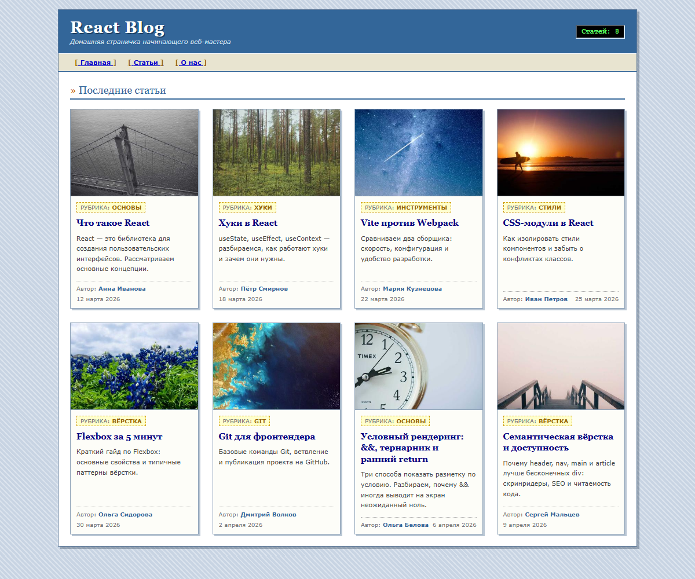
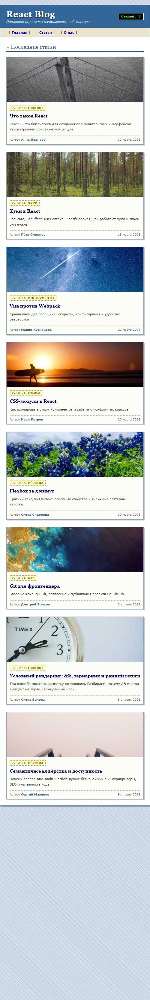

<div align="center">

**МИНИСТЕРСТВО НАУКИ И ВЫСШЕГО ОБРАЗОВАНИЯ РОССИЙСКОЙ ФЕДЕРАЦИИ**<br>
Омский государственный технический университет<br>
Факультет информационных технологий и компьютерных систем

&nbsp;

**ОТЧЁТ**<br>
по лабораторной работе № 1<br>
по дисциплине «Разработка web-приложений»<br>
**React + Vite: компоненты, CSS-модули, список карточек**

&nbsp;

</div>

Направление 09.03.02 «Информационные системы и технологии»,<br>
профиль «Цифровые медиатехнологии, виртуальная и дополненная реальность»

Выполнил: студент группы ИСТ-251 Ковалёв М. А.<br>
Проверил: ______________________

<div align="center">

Омск, 2026

</div>

---


## 1. Цель работы

Освоить базовый инструментарий React-разработчика: создать проект на Vite,
структурировать его с помощью семантической разметки и CSS-модулей, собрать
интерфейс из переиспользуемых JSX-компонентов, подключить данные для карточек
статей и сохранить проект в Git.

## 2. Краткие теоретические сведения

**Vite.** Сборщик и сервер разработки. В режиме разработки отдаёт браузеру
нативные ES-модули и обрабатывает только запрошенные файлы, поэтому стартует
быстро; команда `npm run build` собирает оптимизированную версию в папку `dist/`.
Проект создаётся командой `npm create vite@latest my-grid -- --template react`:
`--` отделяет аргументы самой команды `create` от аргументов, которые
передаются шаблону (`--template react`).

**Компонент и JSX.** Компонент — функция, возвращающая разметку. JSX — это
HTML-подобный синтаксис внутри JavaScript; выражения подставляются в фигурных
скобках `{...}`. Компоненты собираются в дерево: `App` содержит `Header` и
`ArticleList`, а тот — набор `ArticleCard`.

**Пропсы.** Данные передаются от родителя к потомку через атрибуты тега
(`<ArticleCard article={article} />`). Пропсы доступны только для чтения,
поток данных идёт сверху вниз.

**CSS-модули.** Файл вида `Имя.module.css`: при импорте Vite заменяет каждое
имя класса на уникальное, поэтому стили одного компонента не конфликтуют со
стилями другого. В JSX класс берётся из импортированного объекта:
`className={styles.card}`.

**Списки и `key`.** Массив данных превращается в массив элементов методом
`.map()`. Атрибут `key` (уникальный и стабильный, например `id`) помогает React
сопоставлять элементы списка при перерисовке.

**Flexbox.** `display: flex` с `flex-wrap: wrap` переносит элементы на новую
строку, а `flex: 1 1 calc(...)` задаёт базовую ширину колонки; изменяя её в
медиа-запросах, получают адаптивную сетку (4 → 3 → 2 → 1 колонка).

**Семантическая разметка.** Теги `header`, `nav`, `main`, `section`, `article`,
`footer`, `time` описывают смысл блока, а не только внешний вид — это важно для
скринридеров, поисковых систем и читаемости кода.

## 3. Формулировка задания

1. Создать проект на Vite + React (JavaScript), очистить шаблон.
2. Создать структуру `components/Header`, `ArticleCard`, `ArticleList`,
   `data/articles.js`, у каждого компонента — свой CSS-модуль.
3. Реализовать `Header` (заголовок и навигация), `ArticleCard` (карточка статьи
   из пропса `article`), `ArticleList` (сетка карточек на Flexbox: 3 → 2 → 1
   колонка), собрать страницу в `App.jsx`.
4. Проверить в браузере (`npm run dev`) и собрать проект (`npm run build`).
5. Сохранить проект в Git.
6. Задания для самопроверки:
   1. добавить 7-ю и 8-ю карточки в `articles.js`;
   2. сделать 4 карточки в ряд на широком экране;
   3. вынести навигацию в отдельный компонент `Nav.jsx` со своим CSS-модулем;
   4. добавить в `Header` счётчик статей из `articles.length`.

Оформление страницы выполнено в стиле блогов 2000-х (рамки, жёсткие тени,
шрифты Verdana и Georgia) — это авторское решение, на структуру компонентов
оно не влияет.

## 4. Листинг программы

Структура проекта:

```text
lab01/
├── index.html
├── package.json
├── vite.config.js
├── eslint.config.js
└── src/
    ├── main.jsx
    ├── App.jsx
    ├── App.module.css
    ├── index.css
    ├── data/articles.js
    └── components/
        ├── Header/       Header.jsx, Header.module.css
        ├── Nav/          Nav.jsx, Nav.module.css
        ├── ArticleList/  ArticleList.jsx, ArticleList.module.css
        └── ArticleCard/  ArticleCard.jsx, ArticleCard.module.css
```

**index.html**

```html
<!doctype html>
<html lang="ru">
  <head>
    <meta charset="UTF-8" />
    <link rel="icon" type="image/svg+xml" href="/favicon.svg" />
    <meta name="viewport" content="width=device-width, initial-scale=1.0" />
    <title>React Blog</title>
  </head>
  <body>
    <div id="root"></div>
    <script type="module" src="/src/main.jsx"></script>
  </body>
</html>
```

**src/main.jsx** — точка входа React

```jsx
import { StrictMode } from 'react'
import { createRoot } from 'react-dom/client'
import './index.css'
import App from './App.jsx'

createRoot(document.getElementById('root')).render(
  <StrictMode>
    <App />
  </StrictMode>,
)
```

**src/index.css** — базовый сброс и фон страницы

```css
* {
  margin: 0;
  padding: 0;
  box-sizing: border-box;
}

body {
  font-family: Verdana, Geneva, Tahoma, sans-serif;
  font-size: 12px;
  color: #333333;
  background-color: #c8d4e3;
  background-image: repeating-linear-gradient(
    45deg,
    rgba(255, 255, 255, 0.35) 0px,
    rgba(255, 255, 255, 0.35) 2px,
    transparent 2px,
    transparent 6px
  );
}
```

**src/App.jsx** — сборка страницы

```jsx
import Header from './components/Header/Header'
import ArticleList from './components/ArticleList/ArticleList'
import styles from './App.module.css'

function App() {
  return (
    <div className={styles.app}>
      <Header />
      <main className={styles.main}>
        <h2 className={styles.heading}>Последние статьи</h2>
        <ArticleList />
      </main>
    </div>
  )
}

export default App
```

**src/App.module.css**

```css
.app {
  max-width: 1000px;
  margin: 16px auto;
  background-color: #ffffff;
  border: 1px solid #5c7899;
  box-shadow: 4px 4px 0 rgba(44, 62, 85, 0.35);
}

.main {
  padding: 20px;
}

.heading {
  font-family: Georgia, 'Times New Roman', serif;
  font-size: 18px;
  font-weight: normal;
  color: #336699;
  border-bottom: 2px solid #336699;
  padding-bottom: 4px;
  margin-bottom: 16px;
}

.heading::before {
  content: '» ';
  color: #cc6600;
}
```

**src/data/articles.js** — данные карточек

```js
// Данные для карточек. Компоненты ничего не знают о конкретных статьях:
// число карточек определяется только длиной этого массива.
const articles = [
  {
    id: 1,
    title: 'Что такое React',
    excerpt:
      'React — это библиотека для создания пользовательских интерфейсов. Рассматриваем основные концепции.',
    author: 'Анна Иванова',
    date: '12 марта 2026',
    tag: 'Основы',
    image: 'https://picsum.photos/seed/react1/400/250',
  },
  {
    id: 2,
    title: 'Хуки в React',
    excerpt:
      'useState, useEffect, useContext — разбираемся, как работают хуки и зачем они нужны.',
    author: 'Пётр Смирнов',
    date: '18 марта 2026',
    tag: 'Хуки',
    image: 'https://picsum.photos/seed/hooks2/400/250',
  },
  {
    id: 3,
    title: 'Vite против Webpack',
    excerpt:
      'Сравниваем два сборщика: скорость, конфигурация и удобство разработки.',
    author: 'Мария Кузнецова',
    date: '22 марта 2026',
    tag: 'Инструменты',
    image: 'https://picsum.photos/seed/vite3/400/250',
  },
  {
    id: 4,
    title: 'CSS-модули в React',
    excerpt:
      'Как изолировать стили компонентов и забыть о конфликтах классов.',
    author: 'Иван Петров',
    date: '25 марта 2026',
    tag: 'Стили',
    image: 'https://picsum.photos/seed/css4/400/250',
  },
  {
    id: 5,
    title: 'Flexbox за 5 минут',
    excerpt:
      'Краткий гайд по Flexbox: основные свойства и типичные паттерны вёрстки.',
    author: 'Ольга Сидорова',
    date: '30 марта 2026',
    tag: 'Вёрстка',
    image: 'https://picsum.photos/seed/flex5/400/250',
  },
  {
    id: 6,
    title: 'Git для фронтендера',
    excerpt:
      'Базовые команды Git, ветвление и публикация проекта на GitHub.',
    author: 'Дмитрий Волков',
    date: '2 апреля 2026',
    tag: 'Git',
    image: 'https://picsum.photos/seed/git6/400/250',
  },
  // 7-я и 8-я карточки — задание для самопроверки №1
  {
    id: 7,
    title: 'Условный рендеринг: &&, тернарник и ранний return',
    excerpt:
      'Три способа показать разметку по условию. Разбираем, почему && иногда выводит на экран неожиданный ноль.',
    author: 'Ольга Белова',
    date: '6 апреля 2026',
    tag: 'Основы',
    image: 'https://picsum.photos/seed/condrender/400/250',
  },
  {
    id: 8,
    title: 'Семантическая вёрстка и доступность',
    excerpt:
      'Почему header, nav, main и article лучше бесконечных div: скринридеры, SEO и читаемость кода.',
    author: 'Сергей Мальцев',
    date: '9 апреля 2026',
    tag: 'Вёрстка',
    image: 'https://picsum.photos/seed/semantics/400/250',
  },
]

export default articles
```

**src/components/Header/Header.jsx**

```jsx
import styles from './Header.module.css'
import Nav from '../Nav/Nav'
import articles from '../../data/articles'

function Header() {
  return (
    <header className={styles.header}>
      <div className={styles.container}>
        <div className={styles.brand}>
          <h1 className={styles.logo}>React Blog</h1>
          <p className={styles.tagline}>
            Домашняя страничка начинающего веб-мастера
          </p>
        </div>
        {/* Количество статей берём прямо из данных */}
        <span className={styles.counter}>Статей: {articles.length}</span>
      </div>
      <Nav />
    </header>
  )
}

export default Header
```

**src/components/Header/Header.module.css**

```css
.header {
  background-color: #336699;
  border-bottom: 3px double #ffffff;
  color: #ffffff;
}

.container {
  display: flex;
  flex-wrap: wrap;
  gap: 12px;
  align-items: center;
  justify-content: space-between;
  padding: 14px 20px;
}

.brand {
  display: flex;
  flex-direction: column;
  gap: 2px;
}

.logo {
  font-family: Georgia, 'Times New Roman', serif;
  font-size: 28px;
  font-weight: bold;
  letter-spacing: 1px;
  text-shadow: 2px 2px 0 #1f4061;
}

.tagline {
  font-size: 11px;
  font-style: italic;
  color: #cfe0f0;
}

.counter {
  font-family: 'Courier New', Courier, monospace;
  font-size: 12px;
  font-weight: bold;
  color: #66ff66;
  background-color: #000000;
  border: 2px inset #99aabb;
  padding: 3px 8px;
}
```

**src/components/Nav/Nav.jsx**

```jsx
import styles from './Nav.module.css'

// Навигация вынесена из Header в отдельный компонент (задание для самопроверки №3)
function Nav() {
  return (
    <nav className={styles.nav}>
      <a href="#" className={styles.link}>Главная</a>
      <a href="#" className={styles.link}>Статьи</a>
      <a href="#" className={styles.link}>О нас</a>
    </nav>
  )
}

export default Nav
```

**src/components/Nav/Nav.module.css**

```css
.nav {
  display: flex;
  flex-wrap: wrap;
  gap: 4px;
  background-color: #e8e4d0;
  border-top: 1px solid #ffffff;
  padding: 6px 20px;
}

.link {
  font-size: 11px;
  font-weight: bold;
  color: #0000cc;
  text-decoration: underline;
  padding: 2px 8px;
}

.link::before {
  content: '[ ';
  color: #996600;
}

.link::after {
  content: ' ]';
  color: #996600;
}

.link:hover {
  color: #cc0000;
  background-color: #fffbe0;
}

.link:active {
  color: #663399;
}
```

**src/components/ArticleList/ArticleList.jsx**

```jsx
import styles from './ArticleList.module.css'
import ArticleCard from '../ArticleCard/ArticleCard'
import articles from '../../data/articles'

// Для каждой статьи из массива рисуем карточку; key помогает React
// отличать элементы списка друг от друга при перерисовке
function ArticleList() {
  return (
    <section className={styles.list}>
      {articles.map((article) => (
        <ArticleCard key={article.id} article={article} />
      ))}
    </section>
  )
}

export default ArticleList
```

**src/components/ArticleList/ArticleList.module.css** — сетка 4 → 3 → 2 → 1

```css
.list {
  display: flex;
  flex-wrap: wrap;
  gap: 24px;
}

/* Задание 6.2: 4 карточки в ряд на широком экране.
   Для 3 в ряд вернуть делитель 3 и вычитаемое 48px (gap * (3 - 1)). */
.list > * {
  flex: 1 1 calc((100% - 72px) / 4);
  max-width: calc((100% - 72px) / 4);
}

@media (max-width: 1024px) {
  .list > * {
    flex: 1 1 calc((100% - 48px) / 3);
    max-width: calc((100% - 48px) / 3);
  }
}

@media (max-width: 768px) {
  .list > * {
    flex: 1 1 calc((100% - 24px) / 2);
    max-width: calc((100% - 24px) / 2);
  }
}

@media (max-width: 520px) {
  .list > * {
    flex: 1 1 100%;
    max-width: 100%;
  }
}
```

**src/components/ArticleCard/ArticleCard.jsx**

```jsx
import styles from './ArticleCard.module.css'

// Карточка получает одну статью пропом и сразу разбирает объект на поля
function ArticleCard({ article }) {
  const { title, excerpt, author, date, tag, image } = article

  return (
    <article className={styles.card}>
      
      <div className={styles.body}>
        <span className={styles.tag}>{tag}</span>
        <h2 className={styles.title}>{title}</h2>
        <p className={styles.excerpt}>{excerpt}</p>
        <footer className={styles.footer}>
          <span className={styles.author}>{author}</span>
          <time className={styles.date}>{date}</time>
        </footer>
      </div>
    </article>
  )
}

export default ArticleCard
```

**src/components/ArticleCard/ArticleCard.module.css**

```css
.card {
  display: flex;
  flex-direction: column;
  background-color: #fdfdf8;
  border: 1px solid #8fa3b8;
  box-shadow: 3px 3px 0 #b9c6d4;
  transition: transform 0.15s, box-shadow 0.15s;
}

.card:hover {
  transform: translateY(-4px);
  box-shadow: 6px 6px 0 #8fa3b8;
}

.image {
  width: 100%;
  height: 150px;
  object-fit: cover;
  display: block;
  border-bottom: 1px solid #8fa3b8;
}

.body {
  display: flex;
  flex-direction: column;
  flex: 1;
  gap: 8px;
  padding: 10px;
}

.tag {
  align-self: flex-start;
  font-size: 10px;
  font-weight: bold;
  text-transform: uppercase;
  color: #996600;
  background-color: #ffffcc;
  border: 1px dashed #cc9900;
  padding: 2px 6px;
}

.tag::before {
  content: 'Рубрика: ';
  font-weight: normal;
  color: #777777;
}

.title {
  font-family: Georgia, 'Times New Roman', serif;
  font-size: 15px;
  font-weight: bold;
  line-height: 1.3;
  color: #000080;
}

.excerpt {
  flex: 1;
  font-size: 11px;
  line-height: 1.6;
  color: #444444;
}

.footer {
  display: flex;
  flex-wrap: wrap;
  justify-content: space-between;
  gap: 6px;
  margin-top: 4px;
  padding-top: 6px;
  border-top: 1px dotted #aaaaaa;
  font-size: 10px;
  color: #777777;
}

.author {
  font-weight: bold;
  color: #336699;
}

.author::before {
  content: 'Автор: ';
  font-weight: normal;
  color: #777777;
}
```

## 5. Результаты выполнения

Сборка (`npm run build`):

```text

> my-grid-kovalev@0.0.0 build
> vite build

vite v8.3.2 building client environment for production...
transforming...
✓ 26 modules transformed.
rendering chunks...
computing gzip size...
dist/index.html                   0.46 kB │ gzip:  0.29 kB
dist/assets/index-ClBcIPP_.css    3.14 kB │ gzip:  1.20 kB
dist/assets/index-CKOiuzYD.js   224.35 kB │ gzip: 70.64 kB

✓ built in 236ms
```

Линтер (`npm run lint`) ошибок не выдал.

Страница на широком экране — шапка со счётчиком статей и навигацией, 8 карточек
по 4 в ряд:



Узкий экран (500 px) — одна колонка:



## 6. Объяснение результатов

* Число карточек определяется только длиной массива `articles`: добавление 7-й
  и 8-й статей не потребовало менять компоненты, сетка перестроилась сама.
* Ширина колонки `calc((100% - 72px) / 4)` — это полная ширина минус три
  промежутка по 24 px, поделённая на четыре. Для трёх колонок вычитаются 48 px
  и делитель 3. Свойство `max-width` с той же формулой не даёт единственной
  карточке в последнем ряду растянуться на всю ширину.
* Медиа-запросы меняют только делитель и вычитаемое: ≤ 1024 px — 3 колонки,
  ≤ 768 px — 2, ≤ 520 px — 1.
* Счётчик в шапке показывает `articles.length`, то есть берёт значение из тех
  же данных, по которым строится список.

## 7. Ответы на контрольные вопросы

**1. Чем Vite отличается от Create React App?** CRA собирает проект webpack'ом
целиком до первого запуска, поэтому старт и пересборка замедляются с ростом
проекта. Vite в режиме разработки не собирает бандл: отдаёт браузеру нативные
ES-модули и преобразует только запрошенные файлы, зависимости обрабатывает
esbuild; для продакшена собирает бандл через Rollup. HMR обновляет только
изменённый модуль. CRA сейчас считается устаревшим.

**2. Что такое CSS-модуль и зачем он нужен? Как обратиться к классу в JSX?**
Обычный CSS глобален, и одинаковые имена классов в разных компонентах
конфликтуют. CSS-модуль (`Имя.module.css`) делает имена классов локальными:
сборщик подменяет их уникальными строками. В JSX: `import styles from
'./Card.module.css'`, затем `className={styles.card}`; для имён с дефисом —
`styles['card-footer']`.

**3. Какие семантические теги HTML5 использованы и почему?** `header` — шапка,
`nav` — навигация, `main` — основное содержимое страницы, `section` — список
статей, `article` — самостоятельная карточка статьи, `footer` внутри карточки —
автор и дата, `time` — дата, `h1`/`h2` — иерархия заголовков. Семантика даёт
доступность (скринридеры ориентируются по этим тегам), лучшее понимание страницы
поисковиками и читаемый код.

**4. Как работает `flex-wrap` и `flex: 1 1 calc(...)`?** `flex-wrap: wrap`
разрешает переносить элементы на новую строку, когда они не помещаются
(по умолчанию они сжимаются в одну строку). `flex: 1 1 calc(...)` — это
`flex-grow: 1` (расти), `flex-shrink: 1` (сжиматься) и `flex-basis` — желаемая
ширина колонки, посчитанная формулой из ширины контейнера и промежутков.

**5. Как данные из `articles.js` попадают в карточки?** `articles.js`
экспортирует массив → `ArticleList` импортирует его и вызывает `.map()` →
для каждой статьи создаётся `<ArticleCard article={article} />` → `ArticleCard`
получает объект как проп и разбирает его на поля `title`, `excerpt`, `author`
и другие, подставляя их в разметку. Поток односторонний, сверху вниз.

**6. Зачем нужен `key` при рендере списка через `.map()`?** По `key` React
сопоставляет элементы нового и старого списка и обновляет только изменившиеся,
сохраняя состояние компонентов. Ключ должен быть уникальным среди соседей и
стабильным между рендерами: подходит `id` из данных, индекс массива при
вставках и удалениях — нет.

## 8. Вывод

Создан проект на Vite + React: страница блога собрана из компонентов `Header`,
`Nav`, `ArticleList`, `ArticleCard`, данные вынесены в `articles.js`, стили
изолированы CSS-модулями, сетка карточек адаптивна. Проект собирается и
проходит линтер без ошибок; выполнены все задания для самопроверки.
