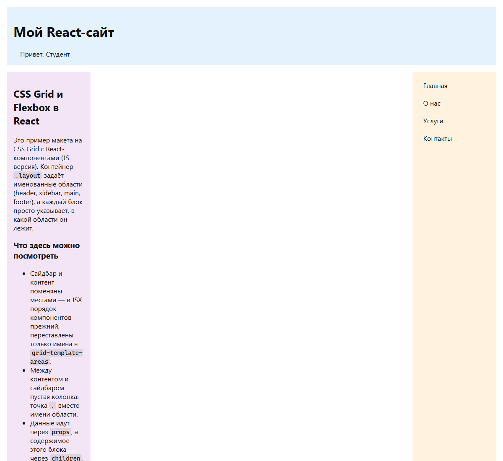
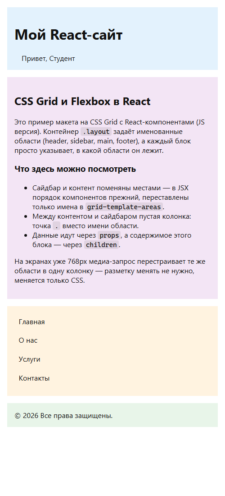

<div align="center">

**МИНИСТЕРСТВО НАУКИ И ВЫСШЕГО ОБРАЗОВАНИЯ РОССИЙСКОЙ ФЕДЕРАЦИИ**<br>
Омский государственный технический университет<br>
Факультет информационных технологий и компьютерных систем

&nbsp;

**ОТЧЁТ**<br>
по лабораторной работе № 2<br>
по дисциплине «Разработка web-приложений»<br>
**React + CSS Grid: макет страницы на компонентах**

&nbsp;

</div>

Направление 09.03.02 «Информационные системы и технологии»,<br>
профиль «Цифровые медиатехнологии, виртуальная и дополненная реальность»

Выполнил: студент группы ИСТ-251 Ковалёв М. А.<br>
Проверил: ______________________

<div align="center">

Омск, 2026

</div>

---


## 1. Цель работы

Собрать макет страницы на CSS Grid из React-компонентов: передавать данные через
`props`, содержимое — через `children`, описать расположение блоков областями
`grid-template-areas` и сделать макет адаптивным.

## 2. Краткие теоретические сведения

**Props и `children`.** Данные передаются в компонент атрибутами тега и
приходят объектом `props`. Особый проп `children` — это всё, что записано между
открывающим и закрывающим тегами компонента. Компонент не знает, что внутри
(текст, список, другой компонент) — он просто выводит `{children}` в нужном
месте, поэтому `children` работает как «слот».

**CSS Grid.** `display: grid` включает сетку у контейнера, его прямые потомки
размещаются по ячейкам. `grid-template-columns` и `grid-template-rows` задают
размеры треков (`250px` — фиксированный, `1fr` — доля свободного места, `auto` —
по содержимому), `gap` — промежутки между ячейками.

**`grid-template-areas`.** Текстовая «карта» макета: каждая строка в кавычках —
строка сетки, каждое слово — имя области в колонке, точка (`.`) — пустая ячейка.
Элемент попадает в область через `grid-area: имя`. Перестроить макет можно, не
трогая разметку, — достаточно поменять карту.

**CSS-переменные и `:root`.** Свойства вида `--gap: 16px`, объявленные в `:root`
(это элемент `<html>`), доступны во всём документе через `var(--gap)`.

**Псевдоклассы** `:hover` и `:active` меняют вид элемента при наведении мыши и
нажатии.

**Медиа-запрос** `@media (max-width: 768px)` применяет правила только на узких
экранах: в нём меняют колонки и карту областей.

## 3. Формулировка задания

Создать проект `my-grid-demo` на Vite + React (JavaScript). Реализовать
компоненты `Layout`, `Header`, `Sidebar`, `MainContent`, `Footer` и стили
`src/styles/index.css` (Grid, переменные, псевдоклассы, адаптив) по методичке.
Выполнить мини-задания:

1. поменять сайдбар и контент местами (изменить `grid-template-areas`);
2. добавить пустую колонку: колонки `200px 1fr 200px` и `.` в карте областей;
3. передать другой контент в `MainContent`;
4. проверить адаптив в DevTools (Toggle Device Toolbar).

## 4. Листинг программы

Структура проекта:

```text
lab02/
├── index.html
├── package.json
├── vite.config.js
└── src/
    ├── main.jsx
    ├── App.jsx
    ├── components/
    │   ├── Layout.jsx
    │   ├── Header.jsx
    │   ├── Sidebar.jsx
    │   ├── MainContent.jsx
    │   └── Footer.jsx
    └── styles/index.css
```

**index.html**

```html
<!doctype html>
<html lang="ru">
  <head>
    <meta charset="UTF-8" />
    <link rel="icon" type="image/svg+xml" href="/favicon.svg" />
    <meta name="viewport" content="width=device-width, initial-scale=1.0" />
    <title>React + CSS Grid (JS)</title>
  </head>
  <body>
    <div id="root"></div>
    <script type="module" src="/src/main.jsx"></script>
  </body>
</html>
```

**src/main.jsx**

```jsx
import { StrictMode } from 'react'
import { createRoot } from 'react-dom/client'
import App from './App.jsx'
import './styles/index.css'

createRoot(document.getElementById('root')).render(
  <StrictMode>
    <App />
  </StrictMode>,
)
```

**src/App.jsx** — данные и содержимое `MainContent` (мини-задание 3)

```jsx
import Layout from './components/Layout.jsx'
import Header from './components/Header.jsx'
import Sidebar from './components/Sidebar.jsx'
import MainContent from './components/MainContent.jsx'
import Footer from './components/Footer.jsx'

// Данные держим в App и передаём вниз через props —
// дочерние компоненты остаются «глупыми» и переиспользуемыми.
const siteTitle = 'Мой React-сайт'
const userName = 'Студент'
const menuItems = ['Главная', 'О нас', 'Услуги', 'Контакты']
// Год считаем один раз вне компонента: вызывать Date прямо в render не стоит
const currentYear = new Date().getFullYear()

function App() {
  return (
    <Layout siteTitle={siteTitle}>
      <Header title={siteTitle} userName={userName} />
      <Sidebar items={menuItems} />
      {/* Всё, что между <MainContent> и </MainContent>,
          приходит внутрь компонента как props.children. */}
      <MainContent>
        <h2>CSS Grid и Flexbox в React</h2>
        <p>
          Это пример макета на CSS Grid с React-компонентами (JS версия).
          Контейнер <code>.layout</code> задаёт именованные области (header,
          sidebar, main, footer), а каждый блок просто указывает, в какой
          области он лежит.
        </p>
        <h3>Что здесь можно посмотреть</h3>
        <ul>
          <li>
            Сайдбар и контент поменяны местами — в JSX порядок компонентов
            прежний, переставлены только имена в{' '}
            <code>grid-template-areas</code>.
          </li>
          <li>
            Между контентом и сайдбаром пустая колонка: точка{' '}
            <code>.</code> вместо имени области.
          </li>
          <li>
            Данные идут через <code>props</code>, а содержимое этого блока —
            через <code>children</code>.
          </li>
        </ul>
        <p>
          На экранах уже 768px медиа-запрос перестраивает те же области в одну
          колонку — разметку менять не нужно, меняется только CSS.
        </p>
      </MainContent>
      <Footer year={currentYear} />
    </Layout>
  )
}

export default App
```

**src/components/Layout.jsx**

```jsx
// Обёртка-сетка: ничего не знает о содержимом,
// просто рендерит детей внутри grid-контейнера .layout.
function Layout({ siteTitle, children }) {
  return (
    <div className="layout" aria-label={`Макет сайта: ${siteTitle}`}>
      {children}
    </div>
  )
}

export default Layout
```

**src/components/Header.jsx**

```jsx
function Header({ title, userName }) {
  return (
    <header className="header">
      <h1>{title}</h1>
      {/* Приветствие показываем, только если userName передан */}
      {userName && <span className="user-badge">Привет, {userName}</span>}
    </header>
  )
}

export default Header
```

**src/components/Sidebar.jsx**

```jsx
function Sidebar({ items }) {
  return (
    <aside className="sidebar">
      <nav>
        <ul>
          {/* key нужен React, чтобы отличать элементы списка друг от друга;
              пункты меню уникальны, поэтому ключом служит сам текст */}
          {items.map((item) => (
            <li key={item}>{item}</li>
          ))}
        </ul>
      </nav>
    </aside>
  )
}

export default Sidebar
```

**src/components/MainContent.jsx**

```jsx
// children — содержимое, переданное из App между тегами компонента.
function MainContent({ children }) {
  return <main className="main">{children}</main>
}

export default MainContent
```

**src/components/Footer.jsx**

```jsx
function Footer({ year }) {
  return (
    <footer className="footer">
      &copy; {year} Все права защищены.
    </footer>
  )
}

export default Footer
```

**src/styles/index.css** — сетка, переменные, псевдоклассы, адаптив

```css
/* Переменные в :root — один раз задали, дальше меняем тему в одном месте */
:root {
  --gap: 16px;
  --header-bg: #e3f2fd;
  --sidebar-bg: #fff3e0;
  --main-bg: #f3e5f5;
  --footer-bg: #e8f5e9;
  --text-color: #111;
}

* {
  box-sizing: border-box;
}

body {
  margin: 0;
  padding: 0;
  font-family: system-ui, -apple-system, sans-serif;
  color: var(--text-color);
}

/* Сетка страницы: три колонки и три строки.
   grid-template-areas рисует макет «картинкой»: каждая строка в кавычках —
   строка сетки, а имена в ней — колонки.
   Точка (.) вместо имени области — пустая ячейка, в неё ничего не попадает.
   Контент и сайдбар поменяны местами (в JSX сайдбар идёт раньше): порядок
   на экране задаёт карта областей, а не порядок компонентов в разметке. */
.layout {
  display: grid;
  grid-template-columns: 200px 1fr 200px;
  grid-template-rows: auto 1fr auto;
  grid-template-areas:
    "header header header"
    "main . sidebar"
    "footer footer footer";
  gap: var(--gap);
  min-height: 80vh;
  padding: var(--gap);
}

/* Каждый блок просто называет область, в которую должен попасть */
.header  { grid-area: header;  background: var(--header-bg);  padding: 1rem; }
.sidebar { grid-area: sidebar; background: var(--sidebar-bg); padding: 1rem; }
.main    { grid-area: main;    background: var(--main-bg);    padding: 1rem; }
.footer  { grid-area: footer;  background: var(--footer-bg);  padding: 1rem; }

.sidebar ul {
  list-style: none;
  padding: 0;
  margin: 0;
}

.sidebar li {
  margin-bottom: 0.5rem;
  padding: 0.4rem 0.6rem;
  border-radius: 6px;
}

/* Псевдоклассы */
.sidebar li:hover {
  background: rgba(0, 0, 0, 0.06);
}

.sidebar li:active {
  background: rgba(0, 0, 0, 0.12);
}

/* Приветствие в шапке */
.user-badge {
  margin-left: 1rem;
}

/* Названия CSS-свойств в тексте — моноширинным шрифтом,
   чтобы не сливались с обычными словами */
code {
  font-family: ui-monospace, 'Cascadia Code', Consolas, monospace;
  font-size: 0.92em;
  padding: 1px 4px;
  border-radius: 4px;
  background: rgba(0, 0, 0, 0.08);
}

/* На узком экране те же области складываем в одну колонку:
   контент поднимается выше меню, разметку в JSX менять не нужно. */
@media (max-width: 768px) {
  .layout {
    grid-template-columns: 1fr;
    grid-template-areas:
      "header"
      "main"
      "sidebar"
      "footer";
  }
}
```

## 5. Результаты выполнения

Сборка (`npm run build`):

```text

> my-grid-demo@0.0.0 build
> vite build

vite v8.3.2 building client environment for production...
transforming...
✓ 21 modules transformed.
rendering chunks...
computing gzip size...
dist/index.html                   0.47 kB │ gzip:  0.31 kB
dist/assets/index-CMjv0p3E.css    1.12 kB │ gzip:  0.52 kB
dist/assets/index-BOc3_ttx.js   222.09 kB │ gzip: 69.76 kB

✓ built in 171ms
```

Линтер (`npm run lint`) ошибок и предупреждений не выдал.

Широкий экран — шапка и подвал на всю ширину, контент слева, пустая колонка
посередине, сайдбар справа:



Узкий экран (500 px) — сработал медиа-запрос, области идут одна под другой:
шапка, контент, меню, подвал (мини-задание 4):



## 6. Объяснение результатов

* **Мини-задание 1.** В карте областей `main` стоит раньше `sidebar`, поэтому
  контент слева, а меню справа. В `App.jsx` порядок компонентов не менялся —
  `Sidebar` по-прежнему идёт раньше `MainContent`: положение на экране задаёт
  сетка, а не порядок в разметке.
* **Мини-задание 2.** Колонок стало три (`200px 1fr 200px`), а в средней
  ячейке строки стоит точка: `"main . sidebar"`. Пустая ячейка не занята ни
  одним блоком, а колонка `1fr` забирает всё свободное место, поэтому контент и
  сайдбар оказываются в узких боковых колонках по 200 px.
* **Мини-задание 3.** `MainContent` не менялся: он выводит `{children}`, а
  заголовки, абзацы и список передаются из `App`.
* **Мини-задание 4.** При ширине до 768 px правило `@media` оставляет одну
  колонку `1fr` и переписывает карту областей, расположив блоки друг под другом.
  Строки сетки при этом остаются прежними (`auto 1fr auto`), четвёртая строка
  создаётся автоматически.
* Цвета и отступы вынесены в переменные `:root`, поэтому тема меняется в одном
  месте. Приветствие в шапке выводится только если передан `userName`
  (`{userName && ...}`).

## 7. Ответы на вопросы

**Что делает `grid-template-areas`?** Описывает макет текстовой картой: строка
в кавычках — строка сетки, слово — область, точка — пустая ячейка. Блоки
привязываются к областям через `grid-area`.

**Что такое `children`?** Особый проп с содержимым между тегами компонента;
компонент выводит его `{children}` в нужном месте и не знает, что внутри.

**Зачем `:root` и переменные?** Переменные из `:root` глобальны, ими можно
пользоваться в любом правиле через `var(--имя)`, а тему менять в одном месте.

**Чем `gap` отличается от `margin`?** `gap` задаёт промежутки между ячейками
сетки одним свойством у контейнера, `margin` пришлось бы прописывать каждому
элементу.

## 8. Вывод

Макет страницы собран на CSS Grid из пяти React-компонентов: данные
передаются через `props`, основное содержимое — через `children`, расположение
блоков описано областями `grid-template-areas`. Выполнены все мини-задания, в
том числе перестройка в одну колонку на узких экранах. Проект собирается и
проходит линтер без замечаний.
