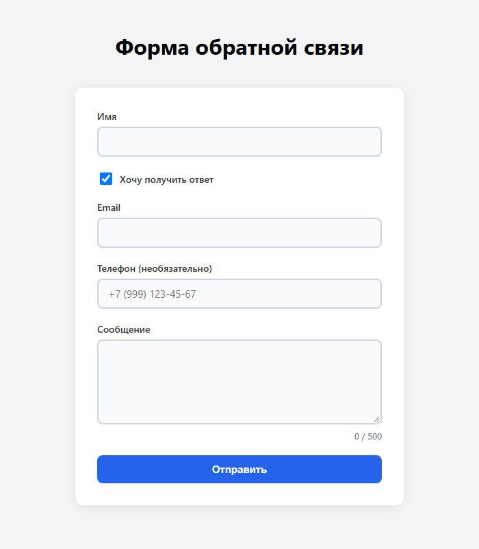
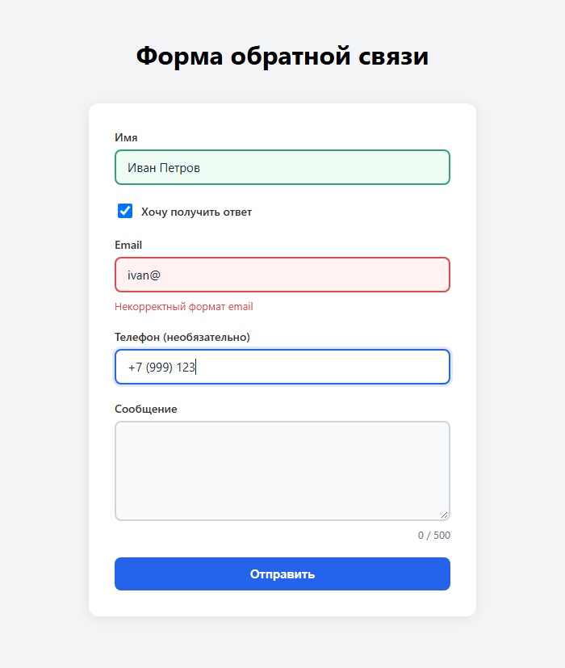
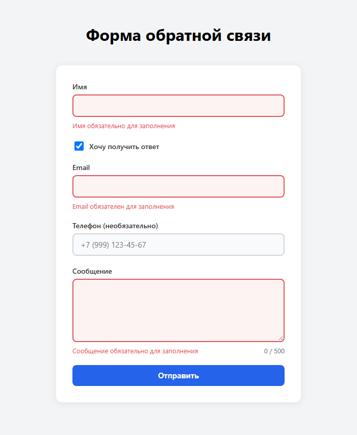
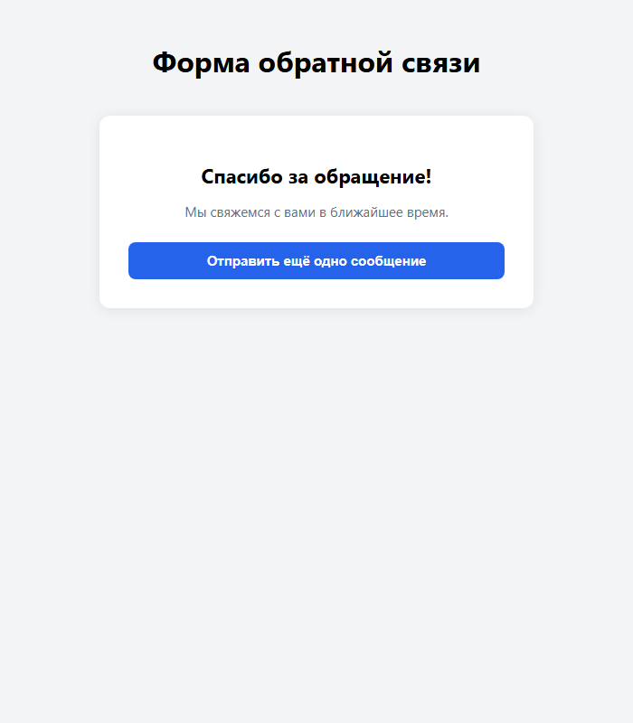

<div align="center">

**МИНИСТЕРСТВО НАУКИ И ВЫСШЕГО ОБРАЗОВАНИЯ РОССИЙСКОЙ ФЕДЕРАЦИИ**<br>
Омский государственный технический университет<br>
Факультет информационных технологий и компьютерных систем

&nbsp;

**ОТЧЁТ**<br>
по лабораторной работе № 3<br>
по дисциплине «Разработка web-приложений»<br>
**Форма обратной связи с валидацией и состояниями в React**

&nbsp;

</div>

Направление 09.03.02 «Информационные системы и технологии»,<br>
профиль «Цифровые медиатехнологии, виртуальная и дополненная реальность»

Выполнил: студент группы ИСТ-251 Ковалёв М. А.<br>
Проверил: ______________________

<div align="center">

Омск, 2026

</div>

---


## 1. Цель работы

Научиться управлять состоянием формы в React с помощью хука `useState`, реализовать
клиентскую валидацию полей и стилизовать различные состояния полей: покой, фокус,
ошибка, успех.

## 2. Краткие теоретические сведения

**Хук `useState`.** Функция React, позволяющая функциональному компоненту хранить
локальное состояние. Возвращает массив из двух элементов — текущего значения и функции
для его обновления: `const [value, setValue] = useState(initialValue)`. Изменение
состояния вызывает перерисовку компонента. Состояние нельзя менять напрямую
(мутировать): для объектов создают новый объект, например `{ ...prev, [field]: value }`
(оператор spread копирует свойства старого объекта в новый).

**Управляемые компоненты.** Поля формы, значение которых хранится в состоянии React:
`value={state}` и `onChange` обновляет состояние. Любой ввод проходит через состояние,
поэтому значение всегда доступно для проверки, маски, счётчика.

**Валидация** — проверка данных до отправки. Выполняется при изменении поля (на лету) и при
отправке формы. Чтобы не раздражать пользователя ошибками во время первого набора, ошибки
показывают только у «тронутых» (`touched`) полей — тех, из которых пользователь уже вышел.

**Состояния поля:** покой, фокус (`:focus`), ошибка, успех — отличаются цветом рамки и
фоном; в React нужный класс добавляется динамически по состоянию.

**Отправка формы.** `e.preventDefault()` в `onSubmit` отменяет стандартную отправку с
перезагрузкой страницы. Ожидание ответа сервера имитируется `setTimeout`; во время
ожидания кнопка заблокирована. Результат показывается условным рендерингом.

## 3. Формулировка задания

Создать проект `feedback-form` (Vite + React). Реализовать компонент `FeedbackForm` с
полями «Имя», «Email», «Сообщение»: состояния значений, ошибок, `touched`, отправки;
функции валидации (имя ≥ 2 символа и только буквы, пробелы, дефис; email по регулярному
выражению; сообщение ≥ 10 символов); обработчики `handleChange`, `handleBlur`,
`handleSubmit`; экран успеха; CSS-стили четырёх состояний поля; динамические классы
`getInputClass`. Выполнить задания для самостоятельной работы:

1. счётчик символов `N / 500` под полем «Сообщение», ограничение длины 500 символов,
   валидация верхнего лимита;
2. поле «Телефон» с проверкой формата `+7 (XXX) XXX-XX-XX` и маской ввода;
3. переключатель «Хочу получить ответ»: если включён — Email обязателен, если выключен —
   его можно оставить пустым.

Решения по неоднозначностям: поле «Телефон» сделано необязательным (но, если введено, должно
быть заполнено целиком); переключатель по умолчанию включён — тогда форма ведёт себя как в
основном задании (Email обязателен).

## 4. Листинг программы

Структура проекта:

```text
lab03/
├── index.html
├── package.json
└── src/
    ├── main.jsx
    ├── index.css
    ├── App.jsx
    ├── App.css
    └── components/
        ├── FeedbackForm.jsx
        └── FeedbackForm.css
```

**src/App.jsx**

```jsx
import FeedbackForm from "./components/FeedbackForm";
import "./App.css";

function App() {
  return (
    <div className="app">
      <h1 style={{ textAlign: "center", fontFamily: "system-ui" }}>
        Форма обратной связи
      </h1>
      <FeedbackForm />
    </div>
  );
}

export default App;
```

**src/components/FeedbackForm.jsx**

```jsx
// src/components/FeedbackForm.jsx
import { useState } from "react";
import "./FeedbackForm.css";

// Максимальная длина сообщения (задание 1)
const MESSAGE_MAX = 500;

// Маска телефона (задание 2): оставляем только цифры и расставляем
// скобки, пробелы и дефисы по шаблону +7 (XXX) XXX-XX-XX.
// Разделитель добавляется только перед следующей цифрой — иначе при
// удалении клавишей Backspace маска тут же возвращала бы стёртый символ.
function formatPhone(raw) {
  let digits = raw.replace(/\D/g, "");
  // Первая 7 или 8 — это код страны, он уже есть в маске (+7)
  if (digits.startsWith("7") || digits.startsWith("8")) {
    digits = digits.slice(1);
  }
  digits = digits.slice(0, 10);
  if (digits.length === 0) return "";

  let result = "+7 (" + digits.slice(0, 3);
  if (digits.length > 3) result += ") " + digits.slice(3, 6);
  if (digits.length > 6) result += "-" + digits.slice(6, 8);
  if (digits.length > 8) result += "-" + digits.slice(8, 10);
  return result;
}

function FeedbackForm() {
  // --- Состояние значений полей ---
  // Каждый инпут — управляемый компонент: его значение хранится в state.
  const [name, setName] = useState("");
  const [email, setEmail] = useState("");
  const [phone, setPhone] = useState("");
  const [message, setMessage] = useState("");
  // Переключатель «Хочу получить ответ» (задание 3): если включён,
  // Email обязателен. По умолчанию включён — как в исходной форме.
  const [wantReply, setWantReply] = useState(true);

  // --- Состояние ошибки валидации ---
  // Храним текст ошибки для каждого поля отдельно.
  // Если ошибки нет — значение null.
  const [errors, setErrors] = useState({
    name: null,
    email: null,
    phone: null,
    message: null,
  });

  // --- Состояние «тронутых» полей ---
  // Поле считается «тронутым» (touched), если пользователь хотя бы раз
  // вышел из него (blur). До этого момента не показываем ошибки,
  // даже если значение невалидно — это снижает раздражение пользователя.
  const [touched, setTouched] = useState({
    name: false,
    email: false,
    phone: false,
    message: false,
  });

  // --- Состояние процесса отправки ---
  // Пока идёт «запрос» — блокируем кнопку и показываем индикатор.
  const [isSubmitting, setIsSubmitting] = useState(false);

  // --- Состояние успешной отправки ---
  // После успешной отправки показываем сообщение вместо формы.
  const [submitted, setSubmitted] = useState(false);

  // Все значения полей одним объектом — чтобы брать значение по имени поля
  const values = { name, email, phone, message };

  // --- Функции валидации ---
  // Имя: минимум 2 символа, только буквы, пробелы и дефис.
  const validateName = (value) => {
    if (!value.trim()) return "Имя обязательно для заполнения";
    if (value.trim().length < 2) return "Минимум 2 символа";
    if (!/^[a-zA-Zа-яА-ЯёЁ\s-]+$/.test(value.trim()))
      return "Только буквы, пробелы и дефис";
    return null; // нет ошибки
  };

  // Email: проверка через регулярное выражение.
  // Правило зависит от переключателя: если ответ не нужен, поле можно
  // оставить пустым (но если что-то введено — формат всё равно проверяем).
  const validateEmail = (value, required = wantReply) => {
    if (!value.trim()) return required ? "Email обязателен для заполнения" : null;
    // Простая, но достаточно надёжная проверка формата.
    if (!/^[^\s@]+@[^\s@]+\.[^\s@]+$/.test(value.trim()))
      return "Некорректный формат email";
    return null;
  };

  // Телефон: необязательный, но если введён — должен быть заполнен целиком.
  const validatePhone = (value) => {
    if (!value) return null;
    if (!/^\+7 \(\d{3}\) \d{3}-\d{2}-\d{2}$/.test(value))
      return "Формат: +7 (XXX) XXX-XX-XX";
    return null;
  };

  // Сообщение: минимум 10 и максимум 500 символов.
  const validateMessage = (value) => {
    if (!value.trim()) return "Сообщение обязательно для заполнения";
    if (value.trim().length < 10) return "Минимум 10 символов";
    if (value.length > MESSAGE_MAX) return `Максимум ${MESSAGE_MAX} символов`;
    return null;
  };

  // Универсальный объект валидаторов — удобно перебирать в цикле.
  const validators = {
    name: validateName,
    email: (value) => validateEmail(value),
    phone: validatePhone,
    message: validateMessage,
  };

  // Обработчик изменения поля.
  // Принимает имя поля и новое значение, проверяет и обновляет состояние.
  const handleChange = (field, rawValue) => {
    // Для телефона сначала применяем маску
    const value = field === "phone" ? formatPhone(rawValue) : rawValue;

    // Обновляем значение соответствующего поля через switch.
    switch (field) {
      case "name":
        setName(value);
        break;
      case "email":
        setEmail(value);
        break;
      case "phone":
        setPhone(value);
        break;
      case "message":
        setMessage(value);
        break;
      // no default
    }

    // Если поле уже тронуто — сразу валидируем при наборе.
    // Если нет — не показываем ошибки, пока пользователь не уйдёт из поля.
    if (touched[field]) {
      setErrors((prev) => ({
        ...prev,
        [field]: validators[field](value),
      }));
    }
  };

  // Обработчик потери фокуса.
  const handleBlur = (field) => {
    // Помечаем поле как тронутое.
    setTouched((prev) => ({ ...prev, [field]: true }));

    // Валидируем текущее значение и записываем результат.
    setErrors((prev) => ({
      ...prev,
      [field]: validators[field](values[field]),
    }));
  };

  // Переключатель «Хочу получить ответ»: правила для Email меняются
  // на лету, поэтому сразу пересчитываем ошибку (если поле уже тронуто).
  // Новое значение переключателя передаём явно: состояние обновится
  // только к следующему рендеру.
  const handleWantReplyChange = (e) => {
    const checked = e.target.checked;
    setWantReply(checked);
    if (touched.email) {
      setErrors((prev) => ({ ...prev, email: validateEmail(email, checked) }));
    }
  };

  // Обработчик отправки формы.
  const handleSubmit = (e) => {
    e.preventDefault(); // Предотвращаем перезагрузку страницы.

    // 1. Валидируем все поля сразу.
    const newErrors = {
      name: validateName(name),
      email: validateEmail(email),
      phone: validatePhone(phone),
      message: validateMessage(message),
    };

    // 2. Записываем ошибки и помечаем все поля как тронутые.
    setErrors(newErrors);
    setTouched({ name: true, email: true, phone: true, message: true });

    // 3. Если хотя бы одна ошибка есть — не отправляем.
    if (Object.values(newErrors).some((err) => err !== null)) {
      return; // Прерываем отправку.
    }

    // 4. Имитируем отправку на сервер.
    setIsSubmitting(true);

    // setTimeout имитирует сетевой запрос с задержкой 1.5 секунды.
    setTimeout(() => {
      setIsSubmitting(false);
      setSubmitted(true);
      // В реальном проекте здесь был бы fetch / axios:
      // fetch("/api/feedback", { method: "POST", body: ... })
    }, 1500);
  };

  // Возвращает строку классов для инпута в зависимости от состояния.
  const getInputClass = (field) => {
    // Базовый класс
    const classes = ["field__input"];

    // Если поле тронуто и есть ошибка — добавляем класс ошибки.
    if (touched[field] && errors[field]) {
      classes.push("field__input--error");
    }
    // Если поле тронуто, ошибки нет и в поле что-то введено —
    // добавляем класс успеха. Пустое необязательное поле «успехом» не красим.
    else if (touched[field] && !errors[field] && values[field].trim()) {
      classes.push("field__input--valid");
    }

    // Для textarea добавляем отдельный класс.
    if (field === "message") {
      classes.push("field__input--textarea");
    }

    return classes.join(" ");
  };

  // Если форма успешно отправлена — показываем благодарность.
  if (submitted) {
    return (
      <div className="feedback-form feedback-form--success">
        <h2 className="feedback-form__title">Спасибо за обращение!</h2>
        <p className="feedback-form__text">
          Мы свяжемся с вами в ближайшее время.
        </p>
        <button
          type="button"
          className="feedback-form__submit"
          onClick={() => {
            // Сбрасываем форму к начальному состоянию.
            setName("");
            setEmail("");
            setPhone("");
            setMessage("");
            setWantReply(true);
            setErrors({ name: null, email: null, phone: null, message: null });
            setTouched({ name: false, email: false, phone: false, message: false });
            setSubmitted(false);
          }}
        >
          Отправить ещё одно сообщение
        </button>
      </div>
    );
  }

  return (
    // noValidate отключает встроенную проверку браузера (type="email"),
    // чтобы все сообщения об ошибках выдавала наша валидация.
    <form className="feedback-form" onSubmit={handleSubmit} noValidate>
      {/* Поле «Имя» */}
      <div className="field">
        <label htmlFor="name" className="field__label">
          Имя
        </label>
        <input
          id="name"
          type="text"
          className={getInputClass("name")}
          value={name}
          onChange={(e) => handleChange("name", e.target.value)}
          onBlur={() => handleBlur("name")}
        />
        {/* Блок ошибки появляется только если поле тронуто И есть ошибка */}
        {touched.name && errors.name && (
          <span className="field__error">{errors.name}</span>
        )}
      </div>

      {/* Переключатель «Хочу получить ответ» (задание 3) */}
      <div className="field field--checkbox">
        <input
          id="wantReply"
          type="checkbox"
          checked={wantReply}
          onChange={handleWantReplyChange}
        />
        <label htmlFor="wantReply" className="field__label">
          Хочу получить ответ
        </label>
      </div>

      {/* Поле «Email» */}
      <div className="field">
        <label htmlFor="email" className="field__label">
          Email{wantReply ? "" : " (необязательно)"}
        </label>
        <input
          id="email"
          type="email"
          className={getInputClass("email")}
          value={email}
          onChange={(e) => handleChange("email", e.target.value)}
          onBlur={() => handleBlur("email")}
        />
        {touched.email && errors.email && (
          <span className="field__error">{errors.email}</span>
        )}
      </div>

      {/* Поле «Телефон» с маской ввода (задание 2) */}
      <div className="field">
        <label htmlFor="phone" className="field__label">
          Телефон (необязательно)
        </label>
        <input
          id="phone"
          type="tel"
          className={getInputClass("phone")}
          value={phone}
          placeholder="+7 (999) 123-45-67"
          onChange={(e) => handleChange("phone", e.target.value)}
          onBlur={() => handleBlur("phone")}
        />
        {touched.phone && errors.phone && (
          <span className="field__error">{errors.phone}</span>
        )}
      </div>

      {/* Поле «Сообщение» со счётчиком символов (задание 1) */}
      <div className="field">
        <label htmlFor="message" className="field__label">
          Сообщение
        </label>
        <textarea
          id="message"
          className={getInputClass("message")}
          value={message}
          maxLength={MESSAGE_MAX}
          onChange={(e) => handleChange("message", e.target.value)}
          onBlur={() => handleBlur("message")}
          rows={5}
        />
        <div className="field__footer">
          <span className="field__error">
            {touched.message && errors.message}
          </span>
          {/* Длину считаем прямо из message.length — отдельное состояние не нужно */}
          <span
            className={
              "field__counter" +
              (message.length >= MESSAGE_MAX ? " field__counter--limit" : "")
            }
          >
            {message.length} / {MESSAGE_MAX}
          </span>
        </div>
      </div>

      <button
        type="submit"
        className="feedback-form__submit"
        disabled={isSubmitting}
      >
        {isSubmitting ? "Отправка…" : "Отправить"}
      </button>
    </form>
  );
}

export default FeedbackForm;
```

**src/components/FeedbackForm.css**

```css
/* src/components/FeedbackForm.css */

/* --- Каркас формы --- */
.feedback-form {
  max-width: 480px;
  margin: 40px auto;
  padding: 32px;
  background: #ffffff;
  border-radius: 12px;
  box-shadow: 0 2px 16px rgba(0, 0, 0, 0.08);
  font-family: system-ui, -apple-system, sans-serif;
}

/* --- Поле --- */
.field {
  margin-bottom: 20px;
  display: flex;
  flex-direction: column;
  gap: 6px;
}

.field__label {
  font-size: 14px;
  font-weight: 600;
  color: #333;
}

/* --- Базовое состояние инпута (покой) --- */
.field__input {
  width: 100%;
  padding: 10px 14px;
  font-size: 15px;
  border: 2px solid #d0d5dd; /* нейтральная рамка */
  border-radius: 8px;
  background: #f9fafb;
  color: #1d2939;
  outline: none;
  /* убираем стандартный outline,
     кастомизируем через box-shadow */
  font-family: inherit;
  transition: border-color 0.2s, box-shadow 0.2s, background 0.2s;
}

/* --- Состояние фокуса --- */
.field__input:focus {
  border-color: #2563eb; /* синяя рамка */
  background: #ffffff;
  box-shadow: 0 0 0 3px rgba(37, 99, 235, 0.15); /* мягкое свечение */
}

/* --- Состояние ошибки --- */
/* Класс добавляется через JSX, когда touched[field] && errors[field] */
.field__input--error {
  border-color: #e5484d; /* красная рамка */
  background: #fef2f2;
}

.field__input--error:focus {
  border-color: #e5484d;
  box-shadow: 0 0 0 3px rgba(229, 72, 77, 0.15);
}

/* --- Состояние успеха --- */
/* Класс добавляется, когда поле тронуто и ошибки нет */
.field__input--valid {
  border-color: #30a46c; /* зелёная рамка */
  background: #f0fdf4;
}

.field__input--valid:focus {
  border-color: #30a46c;
  box-shadow: 0 0 0 3px rgba(48, 164, 108, 0.15);
}

/* --- Текст ошибки --- */
.field__error {
  font-size: 13px;
  color: #e5484d;
  margin-top: 2px;
}

/* --- Textarea --- */
.field__input--textarea {
  resize: vertical;
  min-height: 100px;
}

/* --- Нижняя строка поля «Сообщение»: ошибка слева, счётчик справа --- */
.field__footer {
  display: flex;
  justify-content: space-between;
  gap: 12px;
}

.field__counter {
  margin-left: auto;
  margin-top: 2px;
  font-size: 13px;
  color: #667085;
  white-space: nowrap;
}

/* Лимит исчерпан — счётчик краснеет */
.field__counter--limit {
  color: #e5484d;
  font-weight: 600;
}

/* --- Переключатель «Хочу получить ответ» --- */
.field--checkbox {
  flex-direction: row;
  align-items: center;
  gap: 8px;
}

.field--checkbox input {
  width: 18px;
  height: 18px;
  cursor: pointer;
}

.field--checkbox label {
  cursor: pointer;
}

/* --- Кнопка отправки --- */
.feedback-form__submit {
  width: 100%;
  padding: 12px;
  font-size: 15px;
  font-weight: 600;
  color: #ffffff;
  background: #2563eb;
  border: none;
  border-radius: 8px;
  cursor: pointer;
  transition: background 0.2s;
}

.feedback-form__submit:hover:not(:disabled) {
  background: #1d4ed8;
}

.feedback-form__submit:disabled {
  background: #94a3b8;
  cursor: not-allowed;
}

/* --- Экран успеха --- */
.feedback-form--success {
  text-align: center;
}

.feedback-form__title {
  font-size: 22px;
  margin-bottom: 8px;
}

.feedback-form__text {
  font-size: 15px;
  color: #667085;
  margin-bottom: 24px;
}
```

## 5. Результаты выполнения

Сборка (`npm run build`):

```text
> feedback-form@0.0.0 build
> vite build

vite v8.3.2 building client environment for production...
transforming...
✓ 19 modules transformed.
rendering chunks...
computing gzip size...
dist/index.html                   0.48 kB │ gzip:  0.34 kB
dist/assets/index-DwBgj6dd.css    1.94 kB │ gzip:  0.75 kB
dist/assets/index-DQgDIKQJ.js   224.63 kB │ gzip: 70.42 kB

✓ built in 268ms
```

Линтер (`npm run lint`) ошибок и предупреждений не выдал.

Проверка поведения в браузере (автоматический прогон сценария: ввод с клавиатуры, потеря
фокуса, отправка):

```text
OK   ошибок до взаимодействия нет (только пустой блок под сообщением)
OK   блок ошибки сообщения пуст
OK   пока поле не покинули — ошибки нет
OK   имя из 1 буквы: «Минимум 2 символа»
OK   у поля имени класс --error
OK   цифра в имени: «Только буквы…»
OK   после исправления ошибка исчезла
OK   у корректного имени класс --valid
OK   email «ivan@»: «Некорректный формат email»
OK   маска телефона: 89991234567 → +7 (999) 123-45-67
OK   Backspace стирает номер до конца (маска не «залипает»)
OK   вставка «+7 999 123 45 6» форматируется
OK   неполный телефон: «Формат: +7 (XXX) XXX-XX-XX»
OK   полный телефон — ошибки нет
OK   сообщение «Привет»: «Минимум 10 символов»
OK   счётчик показывает 6 / 500
OK   длина ограничена 500 символами
OK   на лимите счётчик краснеет
OK   ответ нужен, email пуст: «Email обязателен…»
OK   снял «Хочу получить ответ» — ошибка пустого email исчезла
OK   подпись поля Email: «(необязательно)»
OK   вернул переключатель — ошибка вернулась
OK   submit пустой формы показывает ошибки всех обязательных полей
OK   при ошибках отправка не стартует
OK   во время «запроса» кнопка «Отправка…»
OK   и заблокирована
OK   через 1,5 с показан экран «Спасибо за обращение!»
OK   кнопка «Отправить ещё одно» сбрасывает форму

Все проверки пройдены (28)
```

Форма при первом открытии — поля в состоянии покоя, ошибок нет:



Четыре состояния поля на одном кадре: имя заполнено верно (зелёное), email с ошибкой
(красный, под полем текст), телефон в фокусе (синяя рамка, маска применена), сообщение в
покое (серое, счётчик `0 / 500`):



Нажатие «Отправить» на пустой форме — все поля помечаются «тронутыми», показаны ошибки,
отправка не стартует:



Успешная отправка — экран благодарности:



## 6. Объяснение результатов

* Ошибка появляется не при первом символе, а после ухода из поля: `handleBlur` ставит
  `touched[field] = true` и запускает проверку; пока поле не тронуто, `handleChange` ошибки не
  обновляет. После этого проверка идёт на каждый введённый символ.
* `setErrors` и `setTouched` вызываются в виде `prev => ({ ...prev, [field]: ... })`: меняется
  одно поле, остальные сохраняются, а новый объект позволяет React заметить изменение.
* При отправке `handleSubmit` проверяет все поля сразу и помечает их «тронутыми» — иначе
  ошибки не были бы видны у нетронутых полей. Если есть хотя бы одна ошибка, функция
  завершается до «отправки».
* Счётчик символов вычисляется из `message.length` — отдельное состояние не нужно.
  `maxLength` не даёт набрать больше 500 (вставка тоже обрезается), валидатор дополнительно
  проверяет верхний лимит.
* Маска телефона: из введённого оставляются только цифры, первая 7 или 8 (код страны) не
  учитывается, берётся до 10 цифр, и по ним строится `+7 (XXX) XXX-XX-XX`. Разделитель
  добавляется только перед следующей цифрой, поэтому Backspace стирает номер до конца.
* Зависимая валидация: `validateEmail(value, required = wantReply)`. При смене
  переключателя ошибка Email пересчитывается сразу; новое значение передаётся явно, так как
  состояние обновится только к следующему рендеру.
* `<form noValidate>` отключает встроенную проверку браузера для `type="email"` — иначе
  браузер перехватывал бы отправку раньше нашей валидации.

## 7. Ответы на контрольные вопросы

**1. Чем управляемый компонент отличается от неуправляемого? В каких случаях `useRef`
предпочтительнее `useState` для поля формы?** У управляемого компонента значение хранится
в состоянии React (`value` + `onChange`), и React — единственный источник правды: значение
доступно для валидации, маски, счётчика на каждом вводе. У неуправляемого значение хранит
сам DOM, его читают через `ref` (`ref.current.value`) по требованию. `useRef` предпочтительнее,
когда значение не нужно при каждом изменении: простая форма без проверки «на лету», поле
выбора файла (`type="file"`), установка фокуса, работа со сторонними библиотеками; запись в
`ref` не перерисовывает компонент.

**2. Зачем нужно состояние `touched`? Что изменится, если убрать его и показывать ошибки сразу
при вводе?** `touched` отмечает поля, которые пользователь уже покидал, и позволяет
показывать ошибку только для них. Без него ошибки появлялись бы сразу — после первой
введённой буквы («Минимум 2 символа»), хотя человек ещё не закончил ввод, и даже на пустой
форме. С `touched` ошибка приходит после ухода из поля, а затем проверка идёт на лету.

**3. Почему в `setErrors` и `setTouched` используется функциональная форма `prev => ...`?
В каких случаях можно обойтись прямым значением?** Обновляется только один ключ объекта,
остальные нужно сохранить. Функциональная форма получает актуальное состояние на момент
применения обновления (React может объединять несколько вызовов в один рендер, и значение,
захваченное обработчиком, успело бы устареть), а `{ ...prev, ... }` создаёт новый объект
без мутации. Прямое значение подходит, когда новое состояние не зависит от предыдущего:
`setSubmitted(true)`, `setName("")`, сброс `setErrors({ name: null, ... })` целиком.

**4. Как работает `e.preventDefault()` в обработчике `onSubmit`? Что произойдёт без него?**
Событие `submit` по умолчанию запускает действие браузера — отправку формы и перезагрузку
страницы. `preventDefault()` отменяет его, и дальше выполняется наш код (валидация, имитация
запроса). Без вызова страница перезагрузится, состояние React и введённые данные пропадут, а
ошибки не успеют показаться.

**5. Какие состояния полей реализованы в CSS и как они визуально различаются? Предложите
альтернативные визуальные подсказки.** Покой — серая рамка и светлый фон; фокус — синяя
рамка и мягкое свечение (`box-shadow`); ошибка — красная рамка, розовый фон и текст под
полем; успех — зелёная рамка и светло-зелёный фон. Альтернативы: значки ✓/✕ внутри поля,
анимация «встряхивания» при ошибке, цветная подпись, текст ошибки с `aria-live` для
скринридеров; цвет не должен быть единственным признаком (людям с нарушением цветового
зрения нужны текст или значок).

## 8. Вывод

Реализована форма обратной связи на `useState`: управляемые поля, валидация на лету и при
отправке с учётом «тронутых» полей, имитация отправки и экран успеха, стилизация четырёх
состояний поля. Выполнены задания для самостоятельной работы: счётчик символов с лимитом,
поле телефона с маской и формат-проверкой, зависимая валидация Email. Проект собирается и
проходит линтер без замечаний, поведение проверено в браузере.
