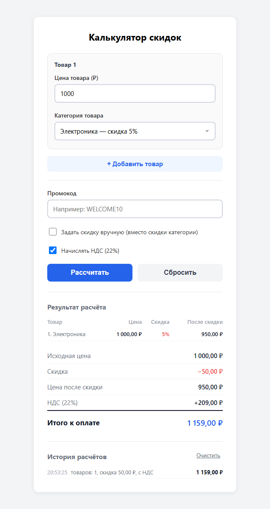
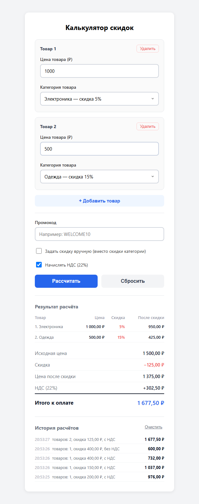
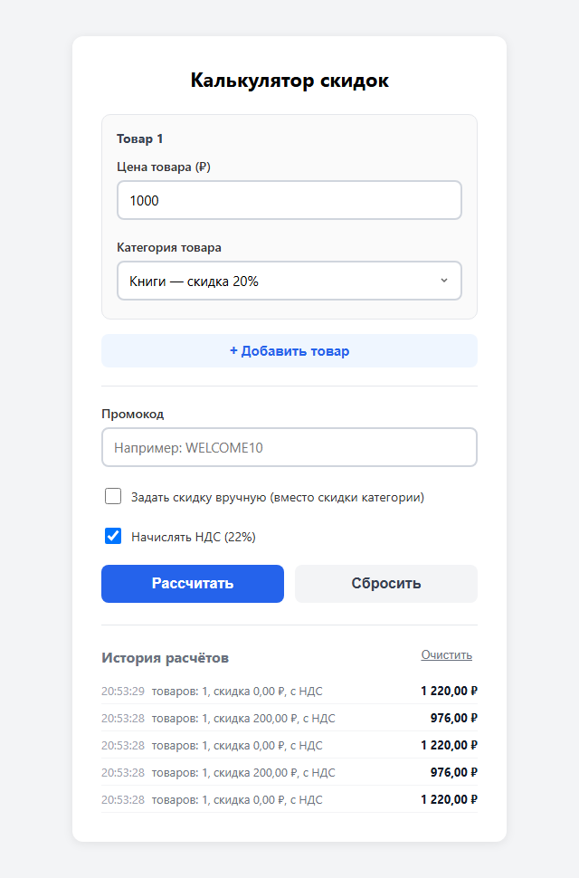

<div align="center">

**МИНИСТЕРСТВО НАУКИ И ВЫСШЕГО ОБРАЗОВАНИЯ РОССИЙСКОЙ ФЕДЕРАЦИИ**<br>
Омский государственный технический университет<br>
Факультет информационных технологий и компьютерных систем

&nbsp;

**ОТЧЁТ**<br>
по лабораторной работе № 4<br>
по дисциплине «Разработка web-приложений»<br>
**Калькулятор скидок**

&nbsp;

</div>

Направление 09.03.02 «Информационные системы и технологии»,<br>
профиль «Цифровые медиатехнологии, виртуальная и дополненная реальность»

Выполнил: студент группы ИСТ-251 Ковалёв М. А.<br>
Проверил: ______________________

<div align="center">

Омск, 2026

</div>

---


## 1. Цель работы

Научиться управлять состоянием формы с несколькими взаимосвязанными полями через
`useState`, обрабатывать события `onChange` и `onClick`, реализовать динамический расчёт
цены со скидкой и НДС.

## 2. Краткие теоретические сведения

**Состояние формы.** Каждое поле — управляемый компонент: значение хранится в `useState`,
`onChange` обновляет его. Цену хранят **строкой**: так можно вводить промежуточные
значения (`""`, `"10."`), а если бы хранилось число, то при стирании `parseFloat("")` давал бы
`NaN`, и поле «залипало». В число строку переводят только при расчёте.

**События.** `onChange` срабатывает при изменении поля (в React для `input` — на каждый
символ) и даёт `e.target.value`; `onClick` — при щелчке по элементу, обычно кнопке, и
запускает действие.

**Регулярное выражение** `/^\d*\.?\d*$/` пропускает только цифры с одной необязательной
точкой: `^` — начало строки, `\d*` — любые цифры, `\.?` — необязательная точка, `$` — конец.

**Производные значения.** Суммы скидки, НДС и итога не хранятся в состоянии, а
вычисляются из `price`, `category` и `calculated` при каждом рендере.

**Формулы.** `скидка = цена × процент / 100`; `цена после скидки = цена − скидка`;
`НДС = цена после скидки × 0,22`; `итого = цена после скидки + НДС`. НДС начисляется
после скидки — на сумму, которую покупатель реально платит.

## 3. Формулировка задания

Создать калькулятор, который принимает цену товара, предлагает выбрать категорию (у каждой
свой процент скидки), рассчитывает сумму скидки, цену после скидки и НДС (22%), выводит итог
к оплате и показывает промежуточные вычисления.

| Категория | Скидка |
|---|---|
| Электроника | 5% |
| Одежда | 15% |
| Продукты | 10% |
| Книги | 20% |
| Другое | 0% |

Выполнить задания для самостоятельной работы:

1. несколько товаров (массив в `useState`), у каждого цена и категория, итог — сумма;
2. промокод `WELCOME10` — ещё 10% скидки поверх категорийной;
3. ползунок ручной скидки 0–50%, заменяющий скидку категории;
4. переключатель «с НДС / без НДС»;
5. история расчётов — последние 5 под формой.

Решения по неоднозначностям: промокод *прибавляется* к процентам скидки (категория + 10%),
ручная скидка *заменяет* скидку категории, промокод действует и поверх неё; кнопка
«Сбросить» историю не стирает (для неё есть отдельная кнопка «Очистить»).

## 4. Листинг программы

Структура проекта:

```text
lab04/
├── index.html
├── package.json
└── src/
    ├── main.jsx
    ├── index.css
    ├── App.jsx
    ├── DiscountCalculator.jsx
    └── DiscountCalculator.css
```

**src/App.jsx**

```jsx
import DiscountCalculator from "./DiscountCalculator";

function App() {
  return <DiscountCalculator />;
}

export default App;
```

**src/DiscountCalculator.jsx**

```jsx
import { useRef, useState } from "react";
import "./DiscountCalculator.css";

// Справочник категорий: ключ — id, значение — { label, discount }
// discount хранится в процентах (число)
const CATEGORIES = [
  { id: "electronics", label: "Электроника", discount: 5 },
  { id: "clothing",    label: "Одежда",      discount: 15 },
  { id: "groceries",   label: "Продукты",    discount: 10 },
  { id: "books",       label: "Книги",       discount: 20 },
  { id: "other",       label: "Другое",      discount: 0 },
];

// Ставка НДС в долях (22%)
const VAT_RATE = 0.22;

// Промокод и его бонус (задание 2): добавляется поверх основной скидки
const PROMO_CODE = "WELCOME10";
const PROMO_BONUS = 10;

// Максимум ручной скидки в процентах (задание 3)
const MAX_CUSTOM_DISCOUNT = 50;

// Сколько последних расчётов хранить в истории (задание 5)
const HISTORY_LIMIT = 5;

// Пустая позиция списка товаров
const createItem = (id) => ({ id, price: "", category: "electronics" });

// Вспомогательная функция: форматирование в рублях
function formatRub(value) {
  return value.toLocaleString("ru-RU", {
    minimumFractionDigits: 2,
    maximumFractionDigits: 2,
  });
}

function DiscountCalculator() {
  // --- Состояние ---
  // Список товаров (задание 1). У каждого своя цена и категория.
  // Цена — строка: так её удобно вводить в controlled input
  const [items, setItems] = useState([createItem(1)]);
  // Счётчик для id новых позиций. useRef подходит: значение нужно хранить
  // между рендерами, но перерисовывать компонент при его изменении не нужно
  const nextId = useRef(2);
  // Признак того, что пользователь нажал «Рассчитать»
  // До первого нажатия результаты не показываем
  const [calculated, setCalculated] = useState(false);
  // Ошибки валидации цен: { [id товара]: "текст" }
  const [errors, setErrors] = useState({});
  // Промокод (задание 2)
  const [promo, setPromo] = useState("");
  // Ручная скидка вместо скидки категории (задание 3)
  const [customEnabled, setCustomEnabled] = useState(false);
  const [customDiscount, setCustomDiscount] = useState(10);
  // Переключатель НДС (задание 4): с НДС / без НДС
  const [withVat, setWithVat] = useState(true);
  // История расчётов (задание 5): последние HISTORY_LIMIT штук
  const [history, setHistory] = useState([]);

  // --- Обработчики событий ---
  // Любое изменение исходных данных делает старые результаты устаревшими
  function invalidate() {
    setCalculated(false);
  }

  // Изменение цены: разрешаем только цифры и точку
  function handlePriceChange(id, value) {
    // Разрешаем пустую строку (чтобы пользователь мог стереть поле)
    // и числа с одной точкой
    if (value === "" || /^\d*\.?\d*$/.test(value)) {
      setItems((prev) =>
        prev.map((item) => (item.id === id ? { ...item, price: value } : item))
      );
      setErrors((prev) => ({ ...prev, [id]: "" })); // Сбрасываем ошибку при вводе
      invalidate(); // Пересчёт нужен заново
    }
  }

  // Изменение категории
  function handleCategoryChange(id, value) {
    setItems((prev) =>
      prev.map((item) => (item.id === id ? { ...item, category: value } : item))
    );
    invalidate(); // Категория изменилась — результаты устарели
  }

  function handleAddItem() {
    // id берём до setItems: функция внутри setItems выполняется позже,
    // когда счётчик уже увеличен
    const id = nextId.current;
    nextId.current += 1;
    setItems((prev) => [...prev, createItem(id)]);
    invalidate();
  }

  function handleRemoveItem(id) {
    setItems((prev) => prev.filter((item) => item.id !== id));
    setErrors((prev) => ({ ...prev, [id]: "" }));
    invalidate();
  }

  // --- Вычисления ---
  // Промокод считаем введённым верно без учёта регистра и пробелов
  const promoActive = promo.trim().toUpperCase() === PROMO_CODE;

  // Итоговый процент скидки для товара: ручная скидка заменяет скидку
  // категории, промокод добавляется сверху. Больше 100% быть не может.
  function getDiscountPercent(item) {
    const category = CATEGORIES.find((c) => c.id === item.category);
    const base = customEnabled ? customDiscount : category ? category.discount : 0;
    return Math.min(base + (promoActive ? PROMO_BONUS : 0), 100);
  }

  // Считает все суммы по текущим данным формы
  function calculate() {
    const lines = items.map((item) => {
      const numPrice = parseFloat(item.price) || 0;
      const percent = getDiscountPercent(item);
      const discountAmount = numPrice * (percent / 100);
      return {
        id: item.id,
        category: CATEGORIES.find((c) => c.id === item.category),
        numPrice,
        percent,
        discountAmount,
        afterDiscount: numPrice - discountAmount,
      };
    });
    const sumPrice = lines.reduce((s, l) => s + l.numPrice, 0);
    const discountAmount = lines.reduce((s, l) => s + l.discountAmount, 0);
    const priceAfterDiscount = sumPrice - discountAmount;
    // НДС начисляется после скидки — на сумму, которую покупатель реально платит
    const vatAmount = withVat ? priceAfterDiscount * VAT_RATE : 0;
    const total = priceAfterDiscount + vatAmount;
    return { lines, sumPrice, discountAmount, priceAfterDiscount, vatAmount, total };
  }

  // Нажатие кнопки «Рассчитать»
  function handleCalculate() {
    // Валидация каждой цены
    const newErrors = {};
    items.forEach((item) => {
      const numPrice = parseFloat(item.price);
      if (!item.price.trim()) {
        newErrors[item.id] = "Введите цену товара"; // пустое поле
      } else if (isNaN(numPrice) || numPrice <= 0) {
        newErrors[item.id] = "Цена должна быть положительным числом";
      }
    });
    setErrors(newErrors);

    if (Object.keys(newErrors).length > 0) {
      setCalculated(false);
      return;
    }

    // Валидация прошла — показываем результаты и пишем расчёт в историю
    setCalculated(true);
    const r = calculate();
    const entry = {
      id: Date.now(),
      time: new Date().toLocaleTimeString("ru-RU"),
      count: items.length,
      discountAmount: r.discountAmount,
      total: r.total,
      withVat,
    };
    setHistory((prev) => [entry, ...prev].slice(0, HISTORY_LIMIT));
  }

  // Сброс формы (историю не трогаем — это журнал прошлых расчётов)
  function handleReset() {
    setItems([createItem(1)]);
    nextId.current = 2;
    setCalculated(false);
    setErrors({});
    setPromo("");
    setCustomEnabled(false);
    setCustomDiscount(10);
    setWithVat(true);
  }

  // Результаты считаем только после нажатия «Рассчитать»
  const result = calculated ? calculate() : null;

  // --- Разметка ---
  return (
    <div className="calculator-wrapper">
      <h2 className="calculator-title">Калькулятор скидок</h2>

      {/* Список товаров: цена и категория для каждой позиции */}
      {items.map((item, index) => (
        <div className="item" key={item.id}>
          <div className="item__header">
            <span className="item__title">Товар {index + 1}</span>
            {items.length > 1 && (
              <button
                type="button"
                className="item__remove"
                onClick={() => handleRemoveItem(item.id)}
              >
                Удалить
              </button>
            )}
          </div>

          {/* Поле ввода цены */}
          <div className="field">
            <label htmlFor={`price-${item.id}`} className="field__label">
              Цена товара (₽)
            </label>
            <input
              id={`price-${item.id}`}
              type="text"
              className={`field__input ${errors[item.id] ? "field__input--error" : ""}`}
              value={item.price}
              onChange={(e) => handlePriceChange(item.id, e.target.value)}
              placeholder="Например: 1000"
              inputMode="decimal"
            />
            {/* Показываем ошибку, если она есть */}
            {errors[item.id] && (
              <span className="field__error">{errors[item.id]}</span>
            )}
          </div>

          {/* Выбор категории */}
          <div className="field">
            <label htmlFor={`category-${item.id}`} className="field__label">
              Категория товара
            </label>
            <select
              id={`category-${item.id}`}
              className="field__input field__select"
              value={item.category}
              onChange={(e) => handleCategoryChange(item.id, e.target.value)}
            >
              {/* Генерируем <option> из справочника категорий */}
              {CATEGORIES.map((cat) => (
                <option key={cat.id} value={cat.id}>
                  {cat.label} — скидка {cat.discount}%
                </option>
              ))}
            </select>
          </div>
        </div>
      ))}

      <button type="button" className="btn btn--add" onClick={handleAddItem}>
        + Добавить товар
      </button>

      {/* Дополнительные параметры расчёта */}
      <div className="options">
        {/* Промокод */}
        <div className="field">
          <label htmlFor="promo" className="field__label">
            Промокод
          </label>
          <input
            id="promo"
            type="text"
            className="field__input"
            value={promo}
            onChange={(e) => {
              setPromo(e.target.value);
              invalidate();
            }}
            placeholder="Например: WELCOME10"
          />
          {promoActive && (
            <span className="field__hint field__hint--ok">
              Промокод применён: дополнительно −{PROMO_BONUS}%
            </span>
          )}
          {promo.trim() && !promoActive && (
            <span className="field__hint">Такого промокода нет</span>
          )}
        </div>

        {/* Ручная скидка (range input) */}
        <div className="field">
          <label className="check">
            <input
              type="checkbox"
              checked={customEnabled}
              onChange={(e) => {
                setCustomEnabled(e.target.checked);
                invalidate();
              }}
            />
            Задать скидку вручную (вместо скидки категории)
          </label>
          {customEnabled && (
            <div className="slider">
              <input
                type="range"
                min="0"
                max={MAX_CUSTOM_DISCOUNT}
                step="1"
                value={customDiscount}
                aria-label="Ручная скидка, %"
                onChange={(e) => {
                  setCustomDiscount(Number(e.target.value));
                  invalidate();
                }}
              />
              <span className="slider__value">{customDiscount}%</span>
            </div>
          )}
        </div>

        {/* Переключатель НДС */}
        <div className="field">
          <label className="check">
            <input
              type="checkbox"
              checked={withVat}
              onChange={(e) => {
                setWithVat(e.target.checked);
                invalidate();
              }}
            />
            Начислять НДС ({VAT_RATE * 100}%)
          </label>
        </div>
      </div>

      {/* Кнопки */}
      <div className="actions">
        <button type="button" className="btn btn--primary" onClick={handleCalculate}>
          Рассчитать
        </button>
        <button type="button" className="btn btn--secondary" onClick={handleReset}>
          Сбросить
        </button>
      </div>

      {/* Результаты — показываем только после расчёта */}
      {result && (
        <div className="results">
          <h3 className="results__title">Результат расчёта</h3>

          {/* Промежуточные вычисления по каждой позиции */}
          <table className="results__table results__table--items">
            <thead>
              <tr>
                <th>Товар</th>
                <th>Цена</th>
                <th>Скидка</th>
                <th>После скидки</th>
              </tr>
            </thead>
            <tbody>
              {result.lines.map((line, index) => (
                <tr key={line.id}>
                  <td>
                    {index + 1}. {line.category.label}
                  </td>
                  <td className="results__value">{formatRub(line.numPrice)} ₽</td>
                  <td className="results__value results__value--discount">
                    {line.percent}%
                  </td>
                  <td className="results__value">{formatRub(line.afterDiscount)} ₽</td>
                </tr>
              ))}
            </tbody>
          </table>

          <table className="results__table">
            <tbody>
              <tr>
                <td>Исходная цена</td>
                <td className="results__value">{formatRub(result.sumPrice)} ₽</td>
              </tr>
              <tr>
                <td>Скидка</td>
                <td className="results__value results__value--discount">
                  −{formatRub(result.discountAmount)} ₽
                </td>
              </tr>
              <tr>
                <td>Цена после скидки</td>
                <td className="results__value">
                  {formatRub(result.priceAfterDiscount)} ₽
                </td>
              </tr>
              <tr>
                <td>{withVat ? `НДС (${VAT_RATE * 100}%)` : "НДС не начисляется"}</td>
                <td className="results__value">
                  {withVat ? "+" : ""}
                  {formatRub(result.vatAmount)} ₽
                </td>
              </tr>
              <tr className="results__row--total">
                <td>Итого к оплате</td>
                <td className="results__value">{formatRub(result.total)} ₽</td>
              </tr>
            </tbody>
          </table>
        </div>
      )}

      {/* История последних расчётов */}
      {history.length > 0 && (
        <div className="history">
          <div className="history__header">
            <h3 className="results__title">История расчётов</h3>
            <button
              type="button"
              className="history__clear"
              onClick={() => setHistory([])}
            >
              Очистить
            </button>
          </div>
          <ul className="history__list">
            {history.map((h) => (
              <li key={h.id}>
                <span className="history__time">{h.time}</span>
                <span>
                  товаров: {h.count}, скидка {formatRub(h.discountAmount)} ₽,{" "}
                  {h.withVat ? "с НДС" : "без НДС"}
                </span>
                <strong>{formatRub(h.total)} ₽</strong>
              </li>
            ))}
          </ul>
        </div>
      )}
    </div>
  );
}

export default DiscountCalculator;
```

**src/DiscountCalculator.css**

```css
/* --- Обёртка --- */
.calculator-wrapper {
  max-width: 480px;
  margin: 40px auto;
  padding: 32px;
  background: #ffffff;
  border-radius: 12px;
  box-shadow: 0 2px 12px rgba(0, 0, 0, 0.08);
  font-family: system-ui, sans-serif;
}

.calculator-title {
  margin: 0 0 24px;
  font-size: 22px;
  text-align: center;
}

/* --- Поля --- */
.field {
  margin-bottom: 20px;
  display: flex;
  flex-direction: column;
}

.field__label {
  margin-bottom: 6px;
  font-size: 14px;
  font-weight: 600;
  color: #333;
}

.field__input {
  padding: 10px 12px;
  font-size: 15px;
  border: 2px solid #d0d5dd;
  border-radius: 8px;
  outline: none;
  transition: border-color 0.2s, box-shadow 0.2s;
  font-family: inherit;
  background: #fff;
}

.field__input:focus {
  border-color: #3b82f6;
  box-shadow: 0 0 0 3px rgba(59, 130, 246, 0.15);
}

.field__input--error {
  border-color: #ef4444;
}

.field__select {
  cursor: pointer;
  appearance: none;
  /* Стрелка вниз — SVG прямо в CSS (Data URI), отдельный файл не нужен */
  background-image: url("data:image/svg+xml,%3Csvg xmlns='http://www.w3.org/2000/svg' width='12' height='12' viewBox='0 0 12 12'%3E%3Cpath d='M3 4l3 3 3-3' stroke='%23666' stroke-width='1.5' fill='none'/%3E%3C/svg%3E");
  background-repeat: no-repeat;
  background-position: right 12px center;
  padding-right: 32px;
}

/* --- Текст ошибки --- */
.field__error {
  margin-top: 4px;
  font-size: 13px;
  color: #ef4444;
}

/* --- Подсказка под полем (промокод) --- */
.field__hint {
  margin-top: 4px;
  font-size: 13px;
  color: #6b7280;
}

.field__hint--ok {
  color: #16a34a;
}

/* --- Позиция списка товаров --- */
.item {
  margin-bottom: 16px;
  padding: 16px 16px 0;
  border: 1px solid #e5e7eb;
  border-radius: 10px;
  background: #fafafa;
}

.item__header {
  display: flex;
  justify-content: space-between;
  align-items: center;
  margin-bottom: 12px;
}

.item__title {
  font-size: 14px;
  font-weight: 700;
  color: #374151;
}

.item__remove {
  padding: 4px 10px;
  font-size: 13px;
  color: #ef4444;
  background: none;
  border: 1px solid #fecaca;
  border-radius: 6px;
  cursor: pointer;
}

.item__remove:hover {
  background: #fef2f2;
}

/* --- Параметры расчёта --- */
.options {
  margin: 20px 0 4px;
  padding-top: 20px;
  border-top: 1px solid #e5e7eb;
}

.check {
  display: flex;
  align-items: center;
  gap: 8px;
  font-size: 14px;
  color: #333;
  cursor: pointer;
}

.check input {
  width: 18px;
  height: 18px;
  cursor: pointer;
}

/* --- Ползунок ручной скидки --- */
.slider {
  display: flex;
  align-items: center;
  gap: 12px;
  margin-top: 10px;
}

.slider input {
  flex: 1;
  cursor: pointer;
}

.slider__value {
  min-width: 44px;
  text-align: right;
  font-weight: 600;
  color: #2563eb;
}

/* --- Кнопки --- */
.actions {
  display: flex;
  gap: 12px;
  margin-bottom: 24px;
}

.btn {
  flex: 1;
  padding: 12px;
  font-size: 16px;
  font-weight: 600;
  border: none;
  border-radius: 8px;
  cursor: pointer;
  transition: background 0.2s;
}

.btn--primary {
  background: #3b82f6;
  color: #fff;
}

.btn--primary:hover {
  background: #2563eb;
}

.btn--primary:active {
  background: #1d4ed8;
}

.btn--secondary {
  background: #f3f4f6;
  color: #374151;
}

.btn--secondary:hover {
  background: #e5e7eb;
}

.btn--add {
  width: 100%;
  flex: none;
  padding: 10px;
  font-size: 15px;
  color: #2563eb;
  background: #eff6ff;
}

.btn--add:hover {
  background: #dbeafe;
}

/* --- Результаты --- */
.results {
  padding-top: 8px;
  border-top: 1px solid #e5e7eb;
}

.results__title {
  margin: 16px 0 12px;
  font-size: 16px;
  color: #6b7280;
}

.results__table {
  width: 100%;
  border-collapse: collapse;
  font-size: 15px;
}

.results__table td {
  padding: 8px 0;
  border-bottom: 1px solid #f3f4f6;
}

.results__table td:first-child {
  color: #6b7280;
}

/* Таблица позиций: компактнее основной */
.results__table--items {
  margin-bottom: 16px;
  font-size: 13px;
}

.results__table--items th {
  padding: 4px 0;
  text-align: right;
  font-weight: 600;
  color: #9ca3af;
}

.results__table--items th:first-child {
  text-align: left;
}

.results__value {
  text-align: right;
  font-weight: 600;
  color: #111827;
  white-space: nowrap;
}

.results__value--discount {
  color: #ef4444;
}

.results__row--total td {
  padding-top: 14px;
  border-top: 2px solid #111827;
  border-bottom: none;
  font-size: 17px;
}

.results__row--total td:first-child {
  color: #111827;
  font-weight: 700;
}

.results__row--total .results__value {
  font-size: 19px;
  color: #2563eb;
}

/* --- История расчётов --- */
.history {
  margin-top: 24px;
  padding-top: 8px;
  border-top: 1px solid #e5e7eb;
}

.history__header {
  display: flex;
  justify-content: space-between;
  align-items: center;
}

.history__clear {
  font-size: 13px;
  color: #6b7280;
  background: none;
  border: none;
  cursor: pointer;
  text-decoration: underline;
}

.history__list {
  margin: 0;
  padding: 0;
  list-style: none;
  font-size: 13px;
  color: #6b7280;
}

.history__list li {
  display: flex;
  flex-wrap: wrap;
  gap: 8px;
  padding: 6px 0;
  border-bottom: 1px solid #f3f4f6;
}

.history__list strong {
  margin-left: auto;
  color: #111827;
}

.history__time {
  color: #9ca3af;
}
```

## 5. Результаты выполнения

Сборка (`npm run build`):

```text
> discount-calculator@0.0.0 build
> vite build

vite v8.3.2 building client environment for production...
transforming...
✓ 18 modules transformed.
rendering chunks...
computing gzip size...
dist/index.html                   0.48 kB │ gzip:  0.34 kB
dist/assets/index-DwG3vn6P.css    3.92 kB │ gzip:  1.33 kB
dist/assets/index-BXPzAKJX.js   227.33 kB │ gzip: 71.07 kB

✓ built in 267ms
```

Линтер (`npm run lint`) ошибок и предупреждений не выдал.

Проверка поведения в браузере (автоматический прогон сценария, суммы проверены вручную
по формулам):

```text
OK   пустая цена: «Введите цену товара»
OK   при ошибке результатов нет
OK   буквы в поле цены не вводятся
OK   вторая точка в цене отклоняется (10.5.5 → 10.55)
OK   цена 0: «Цена должна быть положительным числом»
OK   ошибка сбрасывается при вводе
OK   1000 ₽, электроника: итого 1 159,00 ₽ (950 + НДС 209)
OK   скидка 50, после скидки 950, НДС 209
OK   смена категории скрывает результаты (calculated = false)
OK   книги −20%: 800 + НДС 176 = 976,00 ₽
OK   промокод welcome10 (любой регистр) принят
OK   электроника 5% + промокод 10% = 15%: итого 1 037,00 ₽
OK   ползунок появляется по галочке
OK   значение ползунка отображается
OK   ручная 30% + промокод 10% = 40%: 600 + НДС 132 = 732,00 ₽
OK   без НДС: итого 600,00 ₽
OK   строка НДС: «НДС не начисляется»
OK   «Сбросить» очищает форму
OK   «Добавить товар» создаёт вторую позицию
OK   два товара: 950 + 425 = 1375, НДС 302,50 → 1 677,50 ₽
OK   в таблице позиций две строки
OK   «Удалить» убирает позицию
OK   история хранит только последние 5 расчётов
OK   «Очистить» убирает историю

Все проверки пройдены (24)
```

Начальный вид:


Расчёт для товара 1 000 ₽ в категории «Электроника»: скидка 5% = 50 ₽, после скидки
950 ₽, НДС 22% = 209 ₽, итого 1 159 ₽:



Два товара (1 000 ₽ электроника и 500 ₽ одежда): таблица позиций, общие суммы и история:



История расчётов — последние 5 записей (новые сверху), кнопка «Очистить»:



## 6. Объяснение результатов

* Результаты показываются только при `calculated === true`. Любое изменение цены,
  категории, промокода, ползунка или переключателя вызывает `setCalculated(false)` — старые
  цифры скрываются, пока пользователь снова не нажмёт «Рассчитать»: ввод → действие →
  результат.
* Ввод фильтруется регулярным выражением: буквы и вторая точка отклоняются, символ просто
  не появляется в поле. Пустая цена, не число и цена ≤ 0 дают сообщение под полем.
* 1 000 ₽ в «Электронике»: скидка 5% = 50 ₽, 950 ₽ после скидки, НДС 22% от 950 = 209 ₽,
  итого 1 159 ₽. С промокодом общая скидка 15% (850 ₽ + НДС 187 ₽ = 1 037 ₽); с ручной
  скидкой 30% и промокодом — 40% (600 ₽ + НДС 132 ₽ = 732 ₽); без НДС итог 600 ₽.
* Позиции хранятся массивом `items`; для ключей и ошибок используется `id` позиции, а
  не индекс. Счётчик id лежит в `useRef`: значение нужно хранить между рендерами, но
  перерисовывать компонент при его изменении не требуется.
* История — массив: новая запись ставится первой, `slice(0, 5)` оставляет последние пять.

## 7. Ответы на контрольные вопросы

**1. Почему цена хранится в состоянии как строка, а не как число?** Управляемое поле
работает со строками. Если хранить число, то при стирании символов `parseFloat("")`
возвращает `NaN`, и поле «залипает»; промежуточные значения (`""`, `"10."`) числом не
выразить. Строку удобно редактировать, а в число её переводят только при расчёте.

**2. Зачем нужен флаг `calculated` и что изменится, если его убрать?** Флаг разделяет ввод
и результат: таблица показывается только после нажатия «Рассчитать». Без него результаты
пересчитывались бы при каждом символе — в том числе для пустого или неверного ввода
(нули, `NaN`), а кнопка «Рассчитать» потеряла бы смысл.

**3. Почему при каждом `onChange` сбрасывается `calculated` в `false`?** После изменения
данных показанные цифры устарели. Скрывая их, мы не даём принять старый результат за
актуальный; пользователь осознанно запускает новый расчёт.

**4. Как работает регулярное выражение `/^\d*\.?\d*$/` в `handlePriceChange`?** `^` — начало
строки, `\d*` — ноль или больше цифр, `\.?` — необязательная точка, `\d*` — снова цифры,
`$` — конец. Допустимы `""`, `"10"`, `"10."`, `".5"`, `"10.55"`; буквы, минус и вторая точка
отклоняются — тогда `setPrice` не вызывается, и символ в поле не появляется.

**5. В чём разница между `onClick` и `onChange` для кнопки и поля ввода соответственно?**
`onChange` у поля срабатывает при изменении значения (в React — на каждый введённый символ)
и несёт новое значение в `e.target.value`. `onClick` у кнопки срабатывает при щелчке и
значения не передаёт — он запускает действие («Рассчитать», «Сбросить»).

## 8. Вывод

Реализован калькулятор скидок на `useState`: ввод с фильтрацией и валидацией, выбор
категории, расчёт скидки и НДС 22% с показом промежуточных вычислений. Выполнены все
задания для самостоятельной работы: несколько товаров, промокод, ручная скидка,
переключатель НДС, история расчётов. Проект собирается и проходит линтер без замечаний,
суммы проверены в браузере.
