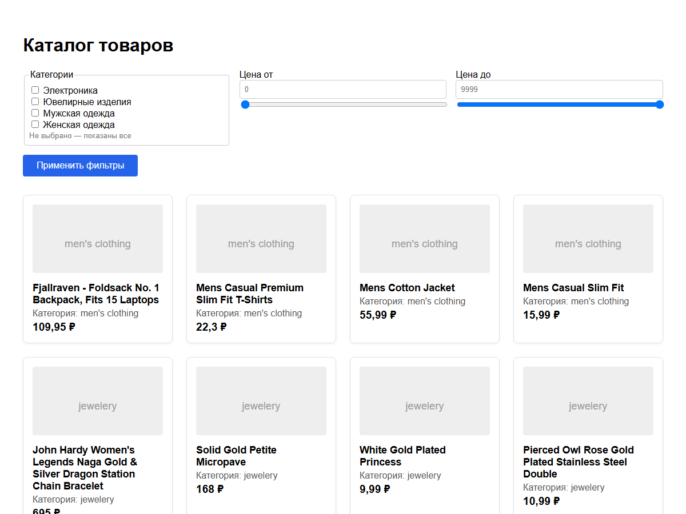
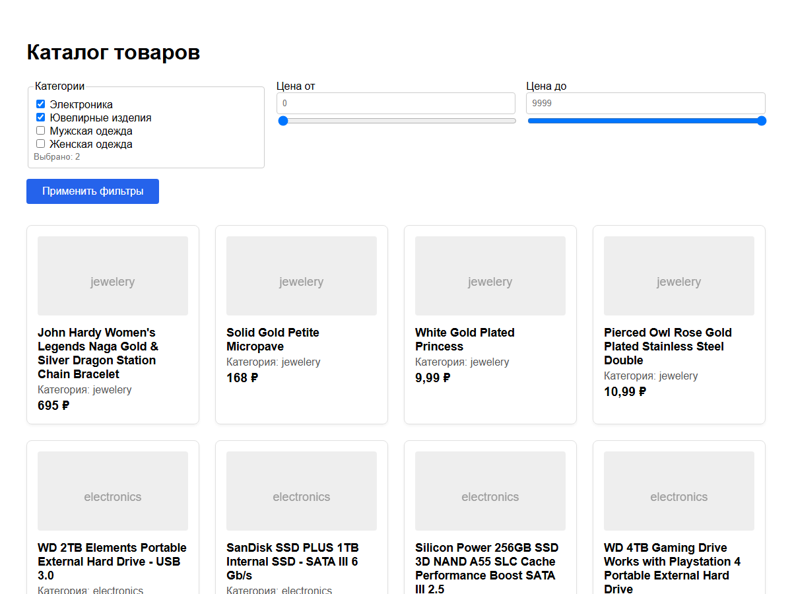
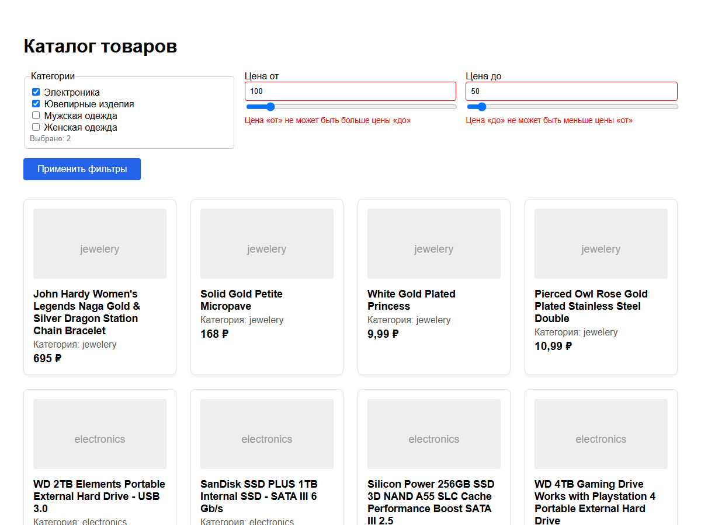
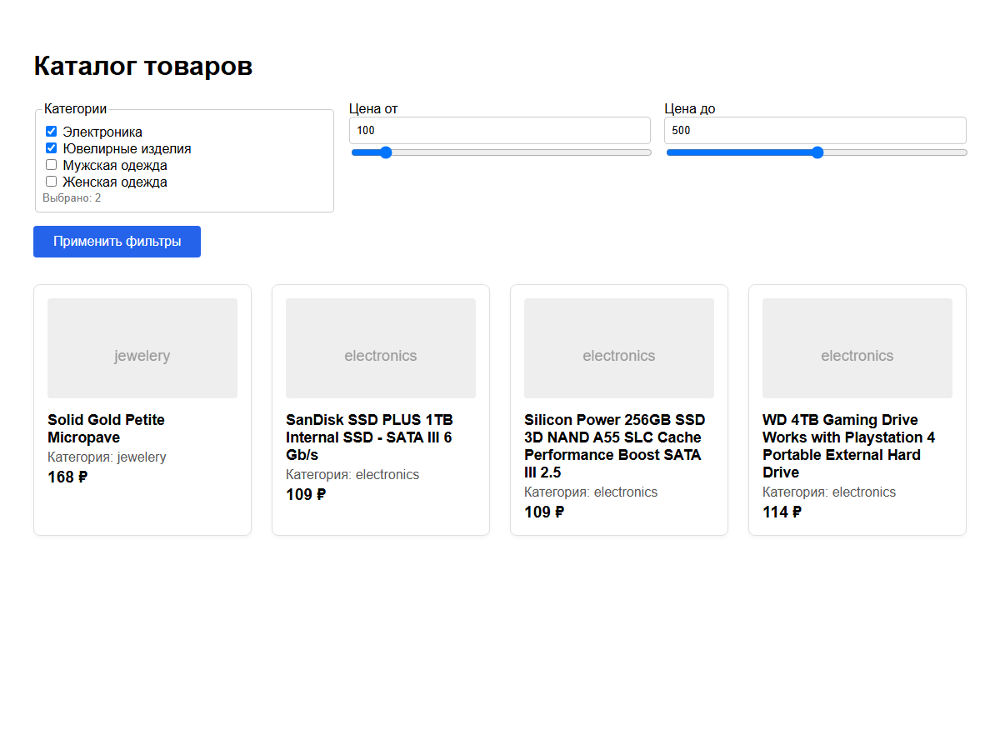
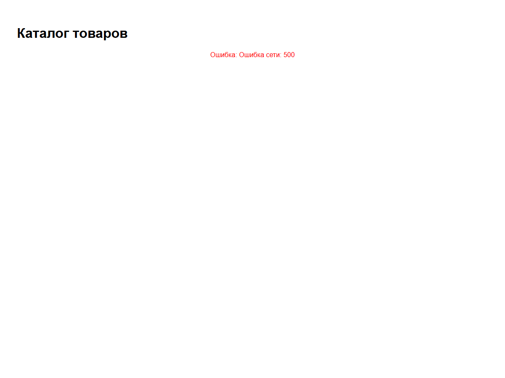

<div align="center">

**МИНИСТЕРСТВО НАУКИ И ВЫСШЕГО ОБРАЗОВАНИЯ РОССИЙСКОЙ ФЕДЕРАЦИИ**<br>
Омский государственный технический университет<br>
Факультет информационных технологий и компьютерных систем

&nbsp;

**ОТЧЁТ**<br>
по лабораторной работе № 5<br>
по дисциплине «Разработка web-приложений»<br>
**Список товаров с фильтрами**

&nbsp;

</div>

Направление 09.03.02 «Информационные системы и технологии»,<br>
профиль «Цифровые медиатехнологии, виртуальная и дополненная реальность»

Выполнил: студент группы ИСТ-251 Ковалёв М. А.<br>
Проверил: ______________________

<div align="center">

Омск, 2026

</div>

---


## 1. Цель работы

Реализовать страницу «Каталог товаров»: загрузка списка товаров через асинхронный запрос
(`fetch`), фильтры по категории и диапазону цены, фильтрация на клиенте, состояния загрузки
и ошибки, отмена запроса при размонтировании компонента (`AbortController`).

## 2. Краткие теоретические сведения

**`useEffect`.** Хук для побочных эффектов: код выполняется после отрисовки. Массив
зависимостей управляет запуском: `[]` — один раз после монтирования, `[a, b]` — при
изменении `a` или `b`. Функция, возвращённая из эффекта, — очистка: выполняется при
размонтировании и перед повторным запуском эффекта.

**`fetch` и `async/await`.** `fetch(url)` возвращает промис с ответом. Ошибкой для него
считается только сетевой сбой; ответы 404 и 500 «успешны», поэтому поле `res.ok` проверяют
вручную. Тело ответа разбирают `await res.json()`.

**`AbortController`.** Объект с сигналом: `fetch(url, { signal })`, а `controller.abort()`
обрывает запрос (промис отклоняется с ошибкой `AbortError`). Вызов `abort()` в функции очистки
`useEffect` не даёт обновлять состояние размонтированного компонента и не оставляет лишний
запрос висеть.

**Состояния асинхронной загрузки:** `loading` (идёт запрос), `error` (текст ошибки),
`products` (данные); интерфейс выбирает, что показать, условным рендерингом.

**Архитектура.** `ProductList` — контейнер (состояние и логика), `ProductCard` —
презентационный компонент (только отображение), `Filters` — управляющий элемент,
отдающий значения родителю.

**Data URI.** Изображение-заглушка задаётся прямо в CSS: `url("data:image/svg+xml,...")`,
отдельный файл не нужен; служебные символы кодируются (`%3C` — `<`, `%23` — `#`).

## 3. Формулировка задания

Создать проект `my-catalog` (Vite + React). Реализовать компоненты `Filters`,
`ProductCard`, `ProductList` и `App`. Данные — `https://fakestoreapi.com/products`, загрузка
в `useEffect` с `AbortController` и проверкой `res.ok`; второй `useEffect` пересчитывает
отфильтрованный список; состояния `loading`, `error`, `products`, `filters`. Фильтры —
категория и диапазон цен; ошибки показываются только после «Применить фильтры»
(отрицательная цена, «от» больше «до»). Задания для самостоятельной работы:

1. выбор нескольких категорий (массив в `useState`);
2. ползунки (`range`) для ручной корректировки минимальной и максимальной цены.

## 4. Листинг программы

Структура проекта:

```text
lab05/
├── index.html
├── package.json
└── src/
    ├── main.jsx
    ├── App.jsx
    └── components/
        ├── ProductList.jsx
        ├── ProductCard.jsx
        └── Filters.jsx
```

**src/App.jsx**

```jsx
import { ProductList } from './components/ProductList';

function App() {
  return (
    <main style={{ padding: '2rem', maxWidth: '1200px', margin: '0 auto', fontFamily: 'Arial, sans-serif' }}>
      <h1 style={{ marginBottom: '1.5rem' }}>Каталог товаров</h1>
      <ProductList />
    </main>
  );
}

export default App;
```

**src/components/ProductList.jsx**

```jsx
import { useState, useEffect } from 'react';
import { Filters } from './Filters';
import { ProductCard } from './ProductCard';

// «Мозги» страницы: загрузка данных, состояния loading / error / products
// и фильтры. Filters и ProductCard только отображают и отдают значения.
export function ProductList() {
  const [products, setProducts] = useState([]);
  const [filteredProducts, setFilteredProducts] = useState([]);
  const [loading, setLoading] = useState(true);
  const [error, setError] = useState(null);

  // Состояние фильтров (пустой массив категорий = «все»)
  const [filters, setFilters] = useState({
    categories: [],
    minPrice: undefined,
    maxPrice: undefined,
  });

  // 1. Загрузка данных при монтировании
  useEffect(() => {
    const controller = new AbortController();

    const loadData = async () => {
      try {
        setLoading(true);
        setError(null);

        // Используем публичный API (fakestoreapi) — он бесплатный и не требует ключей
        const res = await fetch('https://fakestoreapi.com/products', {
          signal: controller.signal,
        });

        // fetch не считает 404/500 ошибкой сам — проверяем res.ok вручную
        if (!res.ok) {
          throw new Error(`Ошибка сети: ${res.status}`);
        }

        const data = await res.json();
        setProducts(data);
      } catch (err) {
        // Если запрос отменили (размонтировали компонент), ошибку не показываем
        if (err.name !== 'AbortError') {
          setError(err.message);
        }
      } finally {
        // После отмены запроса компонент уже размонтирован (или идёт новая
        // загрузка), поэтому индикатор загрузки не трогаем
        if (!controller.signal.aborted) {
          setLoading(false);
        }
      }
    };

    loadData();

    // Функция очистки: отменяет запрос, если компонент удалили до его завершения
    return () => controller.abort();
  }, []);

  // 2. Фильтрация: пересчитываем список при изменении товаров или фильтров
  useEffect(() => {
    let result = products;

    // Категории: товар подходит, если его категория есть в выбранном массиве
    if (filters.categories.length > 0) {
      result = result.filter((p) => filters.categories.includes(p.category));
    }
    if (filters.minPrice !== undefined) {
      result = result.filter((p) => p.price >= filters.minPrice);
    }
    if (filters.maxPrice !== undefined) {
      result = result.filter((p) => p.price <= filters.maxPrice);
    }

    // По заданию пересчёт делается во втором useEffect. Линтер новых версий React
    // считает это лишним (такое значение можно просто вычислять при рендере
    // или через useMemo), поэтому правило здесь отключено осознанно.
    // eslint-disable-next-line react-hooks/set-state-in-effect
    setFilteredProducts(result);
  }, [products, filters]);

  // Верхняя граница шкалы ползунков — самая дорогая позиция, округлённая вверх
  const priceLimit = products.length
    ? Math.ceil(Math.max(...products.map((p) => p.price)))
    : 1000;

  if (loading) return <p style={{ textAlign: 'center' }}>Загрузка товаров...</p>;
  if (error) return <p style={{ color: 'red', textAlign: 'center' }}>Ошибка: {error}</p>;

  return (
    <section>
      <Filters onFilterChange={setFilters} initialFilters={filters} priceLimit={priceLimit} />

      {filteredProducts.length === 0 ? (
        <p style={{ textAlign: 'center', color: '#777' }}>Товары не найдены по выбранным фильтрам.</p>
      ) : (
        <div
          style={{
            display: 'grid',
            gridTemplateColumns: 'repeat(auto-fill, minmax(250px, 1fr))',
            gap: '1.5rem',
          }}
        >
          {filteredProducts.map((product) => (
            <ProductCard key={product.id} product={product} />
          ))}
        </div>
      )}
    </section>
  );
}
```

**src/components/Filters.jsx**

```jsx
import { useState } from 'react';

// Категории fakestoreapi: значение — то, что приходит в product.category
const CATEGORY_OPTIONS = [
  { value: 'electronics', label: 'Электроника' },
  { value: 'jewelery', label: 'Ювелирные изделия' },
  { value: "men's clothing", label: 'Мужская одежда' },
  { value: "women's clothing", label: 'Женская одежда' },
];

// Компонент фильтров. Поля хранят локальное состояние, а родителю значения
// отдаются только по кнопке «Применить фильтры» (и только если нет ошибок).
// priceLimit — верхняя граница для ползунков цены.
export function Filters({ onFilterChange, initialFilters, priceLimit }) {
  // Выбранные категории — массив (задание 1). Пустой массив = «все категории»
  const [localCategories, setLocalCategories] = useState(initialFilters.categories || []);
  const [localMinPrice, setLocalMinPrice] = useState(String(initialFilters.minPrice || ''));
  const [localMaxPrice, setLocalMaxPrice] = useState(String(initialFilters.maxPrice || ''));

  // Ошибки валидации
  const [errors, setErrors] = useState({});

  const validate = () => {
    const errs = {};
    const min = localMinPrice ? Number(localMinPrice) : undefined;
    const max = localMaxPrice ? Number(localMaxPrice) : undefined;

    // Проверка на отрицательные значения
    if (min !== undefined && min < 0) {
      errs.min = 'Цена не может быть отрицательной';
    }
    if (max !== undefined && max < 0) {
      errs.max = 'Цена не может быть отрицательной';
    }

    // Проверка диапазона: только если оба поля заполнены и оба валидны
    if (
      min !== undefined && max !== undefined &&
      min >= 0 && max >= 0 &&
      min > max
    ) {
      errs.min = 'Цена «от» не может быть больше цены «до»';
      errs.max = 'Цена «до» не может быть меньше цены «от»';
    }

    return errs;
  };

  const handleApply = () => {
    const errs = validate();
    setErrors(errs);

    // Если есть ошибки — не отправляем фильтры
    if (Object.keys(errs).length > 0) return;

    onFilterChange({
      categories: localCategories,
      minPrice: localMinPrice ? Number(localMinPrice) : undefined,
      maxPrice: localMaxPrice ? Number(localMaxPrice) : undefined,
    });
  };

  // Включение/выключение категории: добавляем в массив или убираем из него.
  // Состояние не мутируем — каждый раз создаём новый массив.
  const handleCategoryToggle = (value) => {
    setLocalCategories((prev) =>
      prev.includes(value) ? prev.filter((c) => c !== value) : [...prev, value]
    );
  };

  // Сбрасываем ошибку поля при ручном изменении,
  // чтобы она не висела после того, как пользователь начал исправлять значение.
  // Один обработчик обслуживает и числовое поле, и ползунок (задание 2).
  const handleMinChange = (e) => {
    setLocalMinPrice(e.target.value);
    setErrors((prev) => ({ ...prev, min: '' }));
  };

  const handleMaxChange = (e) => {
    setLocalMaxPrice(e.target.value);
    setErrors((prev) => ({ ...prev, max: '' }));
  };

  // Положение ползунков: пустое поле = край шкалы
  const minSliderValue = Number(localMinPrice) || 0;
  const maxSliderValue = localMaxPrice === '' ? priceLimit : Number(localMaxPrice);

  return (
    <div style={{ marginBottom: '2rem' }}>
      <div style={{ display: 'grid', gridTemplateColumns: 'repeat(auto-fit, minmax(200px, 1fr))', gap: '1rem', marginBottom: '1rem' }}>
        <fieldset style={{ border: '1px solid #ccc', borderRadius: '4px', padding: '8px' }}>
          <legend>Категории</legend>
          {CATEGORY_OPTIONS.map((option) => (
            <label key={option.value} style={{ display: 'block', cursor: 'pointer' }}>
              <input
                type="checkbox"
                checked={localCategories.includes(option.value)}
                onChange={() => handleCategoryToggle(option.value)}
              />{' '}
              {option.label}
            </label>
          ))}
          <small style={{ color: '#777' }}>
            {localCategories.length === 0 ? 'Не выбрано — показаны все' : `Выбрано: ${localCategories.length}`}
          </small>
        </fieldset>

        <div>
          <label htmlFor="minPrice">Цена от</label>
          <input
            id="minPrice"
            type="number"
            value={localMinPrice}
            onChange={handleMinChange}
            placeholder="0"
            min="0"
            style={{
              width: '100%',
              boxSizing: 'border-box', // иначе padding выталкивает поле за пределы колонки
              padding: '8px',
              border: errors.min ? '1px solid red' : '1px solid #ccc',
              borderRadius: '4px',
            }}
          />
          <input
            type="range"
            aria-label="Цена от (ползунок)"
            min="0"
            max={priceLimit}
            value={minSliderValue}
            onChange={handleMinChange}
            style={{ width: '100%' }}
          />
          {errors.min && (
            <span style={{ color: 'red', fontSize: '0.85rem', marginTop: '4px', display: 'block' }}>
              {errors.min}
            </span>
          )}
        </div>

        <div>
          <label htmlFor="maxPrice">Цена до</label>
          <input
            id="maxPrice"
            type="number"
            value={localMaxPrice}
            onChange={handleMaxChange}
            placeholder="9999"
            min="0"
            style={{
              width: '100%',
              boxSizing: 'border-box', // иначе padding выталкивает поле за пределы колонки
              padding: '8px',
              border: errors.max ? '1px solid red' : '1px solid #ccc',
              borderRadius: '4px',
            }}
          />
          <input
            type="range"
            aria-label="Цена до (ползунок)"
            min="0"
            max={priceLimit}
            value={maxSliderValue}
            onChange={handleMaxChange}
            style={{ width: '100%' }}
          />
          {errors.max && (
            <span style={{ color: 'red', fontSize: '0.85rem', marginTop: '4px', display: 'block' }}>
              {errors.max}
            </span>
          )}
        </div>
      </div>

      <button
        onClick={handleApply}
        style={{
          padding: '10px 24px',
          background: '#2563eb',
          color: 'white',
          border: 'none',
          borderRadius: '4px',
          cursor: 'pointer',
          fontSize: '1rem',
        }}
      >
        Применить фильтры
      </button>
    </div>
  );
}
```

**src/components/ProductCard.jsx**

```jsx
// Презентационный компонент: только отображает данные.
// Стили оставлены прямо в JSX для наглядности (как в задании),
// в реальном проекте их лучше вынести в CSS-файл.
export function ProductCard({ product }) {
  return (
    <article style={{ border: '1px solid #e0e0e0', padding: '1rem', borderRadius: '8px', boxShadow: '0 2px 4px rgba(0,0,0,0.05)' }}>
      {/* Заглушка картинки через Data URI */}
      <div
        style={{
          height: '120px',
          backgroundImage: `url("data:image/svg+xml,%3Csvg xmlns='http://www.w3.org/2000/svg' width='200' height='120' viewBox='0 0 200 120'%3E%3Crect fill='%23eee' width='200' height='120'/%3E%3Ctext fill='%23999' x='50%' y='55%' text-anchor='middle' font-size='16' font-family='sans-serif'%3E${product.category}%3C/text%3E%3C/svg%3E")`,
          backgroundSize: 'cover',
          marginBottom: '1rem',
          borderRadius: '4px',
        }}
      />
      <h3 style={{ margin: 0, fontSize: '1.1rem' }}>{product.title}</h3>
      <p style={{ margin: '4px 0', color: '#555' }}>Категория: {product.category}</p>
      <p style={{ margin: 0, fontWeight: 'bold', fontSize: '1.2rem' }}>{product.price.toLocaleString('ru-RU')} ₽</p>
    </article>
  );
}
```

## 5. Результаты выполнения

Сборка (`npm run build`):

```text
> my-catalog@0.0.0 build
> vite build

vite v8.3.2 building client environment for production...
transforming...
✓ 18 modules transformed.
rendering chunks...
computing gzip size...
dist/index.html                  0.40 kB │ gzip:  0.30 kB
dist/assets/index-BpXuQ3O9.js  225.38 kB │ gzip: 70.84 kB

✓ built in 213ms
```

Линтер (`npm run lint`) ошибок не выдал.

Проверка поведения в браузере (автоматический прогон сценария; нужен интернет):

```text
OK   сначала «Загрузка товаров…», затем список
OK   загружено 20 товаров fakestoreapi
OK   шкала ползунков 0…1000
OK   подпись «Выбрано: 2»
OK   пока не нажата «Применить», список не меняется
OK   электроника + ювелирные: 6 + 4 = 10 товаров
OK   все карточки — из выбранных категорий
OK   до нажатия «Применить» ошибок нет
OK   min 100 > max 50: две ошибки диапазона
OK   при ошибках фильтры не применяются
OK   правка поля «от» убрала только его ошибку
OK   отрицательная цена: «Цена не может быть отрицательной»
OK   ползунок «от» → поле «от» = 100
OK   ползунок «до» → поле «до» = 500
OK   все цены в диапазоне 100…500 (4 шт.)
OK   нет подходящих: «Товары не найдены…»
OK   пустые фильтры → снова все 20 товаров
OK   ответ 500: «Ошибка: Ошибка сети: 500»
OK   при ошибке фильтры и список не показываются

Все проверки пройдены (19)
```

Каталог после загрузки — 20 товаров, фильтры сверху:



Выбраны две категории (электроника и ювелирные изделия) и нажато «Применить фильтры» —
осталось 10 товаров:



Ошибка валидации: «от» больше «до» — поля подсвечены, фильтры не применяются:



Диапазон 100…500 задан ползунками (значения попали в числовые поля) и применён вместе с
категориями:



Ошибка сети (сервер ответил 500) — вместо каталога сообщение об ошибке:



## 6. Объяснение результатов

* Первый `useEffect` с пустым массивом зависимостей запускает загрузку один раз при
  монтировании. Перед запросом выставляются `loading = true` и `error = null`, после ответа
  данные кладутся в `products`, а в `finally` индикатор загрузки сбрасывается.
* Проверка `res.ok` превращает ответ 500 в ошибку (`Ошибка сети: 500`) — это видно на
  последнем скриншоте. Ошибка `AbortError` (запрос отменён) намеренно не показывается.
* Функция очистки `return () => controller.abort()` вызывается при размонтировании. В
  режиме разработки `StrictMode` монтирует компонент дважды, поэтому первый запрос
  отменяется, и в `finally` индикатор загрузки сбрасывается только для не отменённого запроса.
* Второй `useEffect` с зависимостями `[products, filters]` пересчитывает список: фильтры
  применяются последовательно (категории, минимум, максимум). Правило линтера
  `react-hooks/set-state-in-effect` для этой строки отключено: по заданию пересчёт выполняется
  в эффекте, хотя производное значение можно вычислять при рендере или через `useMemo`.
* `Filters` хранит значения локально и отдаёт их родителю только по кнопке и только если
  `validate()` не нашла ошибок. Правка поля сбрасывает его ошибку, но новая появится лишь
  после следующего нажатия «Применить».
* Несколько категорий — массив строк в состоянии; переключение создаёт новый массив
  (`filter` или `[...prev, value]`), пустой массив означает «все категории».
* Ползунки и числовые поля используют общее состояние и общие обработчики, поэтому всегда
  синхронны; верхняя граница шкалы — самая дорогая позиция, округлённая вверх.
* Цены в API — в долларах; на слайдах они выводятся с «₽», так оставлено в работе.

## 7. Ответы на вопросы

**Зачем нужен `AbortController`?** Он позволяет отменить запрос: `controller.abort()` обрывает
`fetch`, который завершается ошибкой `AbortError`. В функции очистки `useEffect` это не даёт
ответу прийти после ухода со страницы и обновить состояние размонтированного компонента,
а лишний запрос не продолжает работать.

**Почему `fetch` вызывается в `useEffect`, а не прямо в теле компонента?** Тело компонента
выполняется при каждом рендере: запрос уходил бы заново после каждого изменения
состояния, а он сам меняет состояние — получился бы бесконечный цикл. `useEffect` с `[]`
выполняется один раз после монтирования.

**Зачем проверять `res.ok`?** `fetch` отклоняет промис только при сетевом сбое; ответы 404 и 500
для него успешные, поэтому статус проверяют вручную и сами создают ошибку.

**Зачем два `useEffect`?** Первый загружает данные при монтировании (`[]`), второй зависит от
`[products, filters]` и пересчитывает отфильтрованный список, когда изменились данные или
фильтры.

**Чем контейнер отличается от презентационного компонента?** Контейнер (`ProductList`)
хранит состояние и логику, презентационный (`ProductCard`) только отображает полученные
пропсы; так компоненты проще переиспользовать и тестировать.

**Почему в качестве `key` используется `product.id`, а не индекс?** `id` стабилен и уникален,
индекс описывает позицию: при изменении списка React сопоставил бы элементы неверно.

**Почему фильтрация выполняется на клиенте?** Для учебной задачи достаточно одного запроса и
`filter()` по массиву; для больших объёмов фильтры переносят на сервер.

## 8. Вывод

Реализован каталог товаров: загрузка через `fetch` с `AbortController` и проверкой `res.ok`,
состояния загрузки и ошибки, фильтры по нескольким категориям и диапазону цен с валидацией и
ползунками, фильтрация на клиенте. Проект собирается и проходит линтер без ошибок,
поведение (включая ошибку сети) проверено в браузере.
